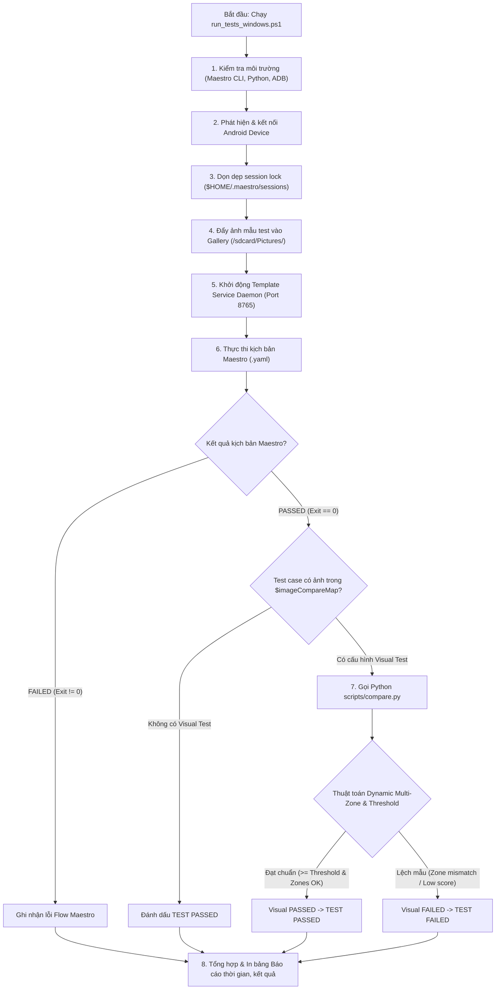

# TÀI LIỆU CHUYỂN GIAO HỆ THỐNG AUTOMATION TESTING
## Dự án: Logo Maker (Android Platform)

> **Mục tiêu**: Tài liệu này đúc kết toàn bộ kiến trúc, luồng hoạt động, cấu trúc mã nguồn, quy chuẩn thiết kế kịch bản và cách thức vận hành hệ thống kiểm thử tự động của dự án Logo Maker. Người mới tiếp nhận dự án có thể đọc và làm chủ hệ thống ngay trong ngày đầu tiên.

---

## 1. Tổng quan Dự án & Ngăn xếp Công nghệ (Tech Stack)

Hệ thống được xây dựng theo mô hình **Hybrid Automation (E2E Flow + Computer Vision Regression)**:

| Thành phần | Công nghệ / Công cụ | Vai trò trong hệ thống |
|:---|:---|:---|
| **Test Engine** | [Maestro Framework](https://maestro.mobile.dev/) | Thực thi kịch bản E2E kiểm thử chức năng giao diện (`.yaml`). |
| **Giao tiếp Thiết bị** | ADB (Android Debug Bridge) | Quản lý thiết bị thật / giả lập, dump cấu trúc XML, chuyển file. |
| **Visual Regression** | Python 3 + OpenCV + PIL | So sánh hình ảnh runtime với ảnh mẫu (Baseline), Dynamic Multi-Zone. |
| **Thị giác Máy tính** | Python HTTP Daemon (`8765`) | Tự động quét và chọn mẫu template trên Canvas không có ID/Text. |
| **Điều phối (Orchestrator)** | PowerShell (`run_tests_windows.ps1`) | Quản lý vòng đời test suite, dọn dẹp session, đo benchmark, báo cáo. |
| **Hỗ trợ Đa nền tảng** | Shell Script (`run_tests_macos.sh`) | Runner tương đương dành cho macOS / Linux. |
| **AI Copilot** | Agent Rules & Maestro Skills | Hỗ trợ AI Agent tự động viết test case và sửa lỗi kịch bản. |

* **Application ID**: `com.thmobile.logomaker`
* **Môi trường chạy chuẩn**: Windows 11 (PowerShell Terminal) hoặc macOS, kết nối với thiết bị Android qua cáp USB / Wi-Fi ADB.

---

## 2. Sơ đồ Kiến trúc & Luồng Thực thi (Execution Workflow)



---

## 3. Cấu trúc Thư mục Chi tiết (Directory Anatomy)

```text
logo-maker/
├── .maestro/
│   ├── config/              # Các luồng dùng chung (Reusable Sub-flows)
│   │   ├── Launch_App.yaml             # Mở app, dập tắt app cũ, xử lý popup mở đầu
│   │   ├── Launch_App_Clear_State.yaml # Mở app với trạng thái xoá sạch cache/dữ liệu
│   │   ├── Close_Ads_Screen.yaml       # Đóng quảng cáo full-screen
│   │   ├── Close_IAP_Screen.yaml       # Đóng màn hình mua gói Premium / Paywall
│   │   ├── Back_Action.yaml            # Nhấn nút Back chuẩn kèm chặn quảng cáo
│   │   └── Navigate_To_Restaurant_Edit.yaml # Luồng điều hướng đến màn hình Edit mẫu nhà hàng
│   ├── test-suite/          # Kịch bản kiểm thử các tính năng chính (16 test cases: TC_00 -> TC_14)
│   ├── free-version/        # Kịch bản riêng biệt dành cho bản Free
│   └── premium-version/     # Kịch bản riêng biệt dành cho bản Premium
├── assets/                  # Ảnh mẫu chuẩn (Baseline Template)
│   ├── Free/                # Ảnh mẫu của bản Free
│   ├── Premium/             # Ảnh mẫu của bản Premium
│   ├── image_Default.png    # Ảnh mẫu seeding vào Gallery máy phục vụ test Background Tool
│   └── template_restaurant_target.png # Ảnh mẫu template để OpenCV tìm kiếm trên màn hình
├── screenshots/             # Nơi Maestro lưu ảnh chụp runtime trong lúc test
│   └── debug/               # Ảnh tạm hỗ trợ debug lỗi visual
├── scripts/                 # Bộ công cụ xử lý Python & JavaScript
│   ├── compare.py           # Engine so sánh ảnh mẫu với ảnh chụp (Core Visual Testing)
│   ├── compare_screens.py   # So sánh 2 ảnh chụp runtime (Expect Same / Different)
│   ├── inspect_ui.py        # Đọc nhanh XML dump phân tích ID, text, bounds
│   ├── merge_reports.py     # Tổng hợp báo cáo từ nhiều Shards thành Markdown
│   ├── template_service.py  # HTTP server daemon (Port 8765) dùng OpenCV tìm template
│   ├── select_premium_template.py # Logic quét tìm template đa tỉ lệ qua ADB
│   └── select_premium_template.js # Cầu nối từ Maestro gọi HTTP vào Python Daemon
├── ui-dumps/                # Chứa file XML phân tích layout lấy từ 'adb uiautomator dump'
├── docs/                    # Tài liệu đặc tả test case và báo cáo
│   ├── test-cases/          # Đặc tả các bộ ca kiểm thử gốc (Mockup, Text, Art...)
│   └── REPORT_ASSETS_PREMIUM_COMPARISON.md # Đối sánh ảnh mẫu Free vs Premium
├── run_tests_windows.ps1    # Script điều phối chính trên Windows
├── run_parallel.ps1         # Script điều phối chạy song song nhiều thiết bị local
├── run_tests.sh             # Script điều phối trên Linux / CI/CD
├── AGENTS.md                # Quy chuẩn hoạt động cho AI Agent
└── .agents/                 # Kỹ năng và luật tự động sinh test case cho AI
```

---

## 4. Các Yếu tố Kỹ thuật Cốt lõi Cần Nắm Rõ

### 4.1. Cơ chế So sánh Hình ảnh: Dynamic Multi-Zone Verification
- **Vấn đề thực tế**: Khi chụp toàn màn hình ($1080 \times 2400$), vùng nền tối và thanh công cụ chiếm tới 90–95% diện tích. Nếu chữ trên Canvas bị xoay hoặc uốn cong sai lệch, thuật toán so sánh thông thường (`cv2.matchTemplate`) vẫn đạt ~93% và dẫn tới **báo Pass sai (False Pass)**.
- **Giải pháp trong [`scripts/compare.py`](file:///d:/logo-maker/scripts/compare.py)**:
  - Chia toàn màn hình theo tỷ lệ tương đối ($H \times W$), chuẩn hóa cho mọi loại độ phân giải thiết bị:
    - **Canvas Zone** ($y: 11\% \to 62\% \times H$): Vùng vẽ/hiển thị logo. Ngưỡng yêu cầu: $\ge 88\%$.
    - **Tool Zone** ($y: 65\% \to 96\% \times H$): Vùng thanh trượt, bảng màu bên dưới. Ngưỡng yêu cầu: $\ge 85\%$.
    - **Status Bar & Navigation Bar**: Bị loại bỏ tự động để tránh lệch do đồng hồ, pin, phím ảo.
  - Bất kỳ zone nào bị sai khác sẽ lập tức bị đánh **`FAILED`** kèm chi tiết lỗi (ví dụ: `Canvas zone mismatch (72% < 88%)`).

### 4.2. Xử lý UI "Mù" bằng Thị giác Máy tính (Template Service Daemon)
- **Vấn đề thực tế**: Màn hình danh sách Template có hàng chục mẫu ảnh. Tất cả đều là `ImageView` không có text, không có ID định danh. Maestro không thể click chính xác mẫu cần test nếu chỉ dùng UI hierarchy.
- **Giải pháp**:
  - `run_tests_windows.ps1` khởi động ngầm `scripts/template_service.py` trên cổng `8765`.
  - Trong kịch bản Maestro, gọi lệnh:
    ```yaml
    - runScript: "../../scripts/select_premium_template.js"
    ```
  - JavaScript này gọi HTTP GET vào `127.0.0.1:8765`.
  - Python Daemon chụp màn hình qua ADB, chạy thuật toán đa tỉ lệ (`cv2.matchTemplate`) so khớp với ảnh mẫu `assets/template_restaurant_target.png`.
  - Khi tìm thấy, Python dùng `adb shell input tap x y` bấm trực tiếp vào tọa độ mẫu và trả về mã `200` cho Maestro tiếp tục.

### 4.3. Quản lý Ảnh Mẫu Đa Phiên bản (Free vs Premium Baseline)
- Runner hỗ trợ tham số `-Version`:
  - `"Auto"` (mặc định): Tự động phát hiện qua Git branch (nếu branch chứa chữ `premium` thì chọn bản Premium, ngược lại là Free).
  - `"Free"` hoặc `"Premium"`: Ép buộc phiên bản mong muốn.
- **Cơ chế Fallback thông minh**: Khi chạy bản Premium, hệ thống sẽ tìm ảnh trong `assets/Premium/Ten_Anh.png`. Nếu chưa có ảnh riêng cho Premium, runner tự động fallback về `assets/Ten_Anh.png` chung.
- **Cập nhật Baseline tự động**: Sử dụng cờ `-UpdateBaseline` để ghi đè ảnh vừa chụp vào thư mục `assets/` tương ứng khi UI ứng dụng thay đổi có chủ đích.

### 4.4. Cơ chế Seeding Dữ liệu vào Gallery Thiết bị
- Trước khi chạy test, script runner tự động kiểm tra và đẩy `assets/image_Default.png` vào `/sdcard/Pictures/` và phát broadcast `MEDIA_SCANNER_SCAN_FILE`.
- Đảm bảo khi test các tính năng chọn ảnh từ thiết bị (Background Tool `TC_02`, `TC_13`, `TC_14`), Gallery điện thoại luôn có sẵn ảnh mẫu hợp lệ để chọn.

### 4.5. Cơ chế Selector Đa Hình (Polymorphic Selectors)
- **Vấn đề thực tế**: Nút Lưu góc trên bên phải màn hình Edit có `resource-id` là `mnItemSave` ở bản Free, nhưng tự động chuyển thành `mnItemSavePremium` ở bản Premium.
- **Giải pháp**: Luôn sử dụng cú pháp Regex `id: ".*mnItemSave.*"` cho cả assertion và tapOn để kịch bản chạy xuyên suốt trên cả hai môi trường mà không cần phân nhánh mã nguồn.

### 4.6. Luồng Lưu / Xuất Đồ họa Thích ứng (Adaptive Save Flow)
- **Bản Free**: Khi bấm lưu Mockup/Logo sẽ bật dialog xác nhận lưu có/không watermark (`tvSaveMockupTitle`, `btn_save_with_watermark`) và hiển thị quảng cáo.
- **Bản Premium**: Không hiển thị dialog watermark, bấm nút Lưu sẽ lưu trực tiếp, hiển thị Toast thành công và nút chuyển ngay lập tức sang nút Chia sẻ (`btnShare`). Kịch bản kiểm thử cần dùng `runFlow: when: visible` để xử lý linh hoạt cho cả hai bản.

---

## 5. Hướng dẫn Vận hành & Lệnh Thực thi Hàng ngày

Tất cả thao tác đều thực hiện trên **PowerShell**:

### 5.1. Chạy một kịch bản kiểm thử cụ thể
```powershell
# Chạy kèm tự động so sánh hình ảnh (khuyên dùng):
.\run_tests_windows.ps1 -File "TC_09_Test_Sub_Tabs_Text_Tool_On_Edit_Screen.yaml" -Version "Premium"

# Chạy bản Free:
.\run_tests_windows.ps1 -File "TC_02_Test_Background_Tool_On_Edit_Screen.yaml" -Version "Free"
```

### 5.2. Chạy toàn bộ thư mục test
```powershell
.\run_tests_windows.ps1 -Folder "test-suite"
```

### 5.3. Chỉ định thiết bị khi kết nối nhiều máy
```powershell
.\run_tests_windows.ps1 -File "TC_09_..." -Device "R3CNA099XKL"
```

### 5.4. Tự động cập nhật ảnh mẫu chuẩn (Update Baseline)
Khi có thay đổi giao diện hợp lệ và bạn muốn lưu lại ảnh chụp hiện tại làm chuẩn mới:
```powershell
.\run_tests_windows.ps1 -File "TC_09_Test_Sub_Tabs_Text_Tool_On_Edit_Screen.yaml" -Version "Premium" -UpdateBaseline
```

### 5.5. Chạy trực tiếp qua Maestro CLI (Chỉ kiểm thử luồng click, bỏ qua so sánh ảnh)
```powershell
maestro test .maestro/test-suite/TC_09_Test_Sub_Tabs_Text_Tool_On_Edit_Screen.yaml
```

---

## 6. Quy chuẩn Viết Kịch bản Mới (Definition of Done)

Khi viết thêm bất kỳ test case nào mới (`.maestro/test-suite/TC_*.yaml`), phải tuân theo 5 nguyên tắc vàng:

1. **Header chuẩn**:
   ```yaml
   appId: com.thmobile.logomaker
   ---
   - runFlow: "../config/Launch_App.yaml"
   ```
2. **Thứ tự ưu tiên Selector**:
   - Ưu tiên 1: `id` (resource-id) — ổn định nhất.
   - Ưu tiên 2: `text` kèm quan hệ không gian (`below`, `above`, `index`).
   - Ưu tiên 3: `point: x%, y%` — chỉ dùng khi vẽ canvas hoặc thanh trượt không có ID con.
3. **Chống Flaky (Anti-flaky)**:
   - Tuyệt đối không dùng `sleep` cứng kéo dài.
   - Sử dụng `extendedWaitUntil: visible: ... timeout: 10000`.
   - Sử dụng `waitForAnimationToEnd`.
   - Luôn có bước dự phòng đóng popup / quảng cáo bất chợt:
     ```yaml
     - runFlow:
         when:
           visible: "Close"
         file: "../config/Close_Ads_Screen.yaml"
     ```
4. **Quy tắc chụp ảnh Assert Visual & Tiền tố Định danh**:
   - Dùng lệnh: `- takeScreenshot: "screenshots/TC_{ID}_{Ten_Tinh_Nang_Ket_Qua}"`
   - Bắt buộc có tiền tố `TC_{ID}_` để chống ghi đè khi chạy song song.
   - Đăng ký vào mảng `$imageCompareMap_Premium` hoặc `$imageCompareMap_Free` trong file [`run_tests_windows.ps1`](file:///d:/logo-maker/run_tests_windows.ps1):
     ```powershell
     "*TC_XX_Ten_File_Test*" = @(
         @{ Template = "assets/Premium/TC_XX_Ten_Anh_Mau.png"; CropId = $null; Screenshot = "screenshots/TC_XX_Ten_Tinh_Nang_Ket_Qua" }
     )
     ```
5. **Cung cấp Ảnh Mẫu Chuẩn (Baseline Assets)**:
   - Tạo ảnh mẫu tương ứng trong thư mục `assets/Premium/` và `assets/Free/` (hoặc chạy runner với cờ `-UpdateBaseline` để tự động lưu ảnh chuẩn sau khi verify bằng mắt).

---

## 7. Cẩm nang Xử lý Sự cố Nhanh (Troubleshooting FAQ)

| Hiện tượng lỗi | Nguyên nhân | Cách khắc phục |
|:---|:---|:---|
| **Lỗi `Session lock` / Không chạy được test** | Maestro trên Windows bị kẹt file session cũ sau khi bị ngắt đột ngột. | Chạy lệnh PowerShell:<br>`Remove-Item "$HOME\.maestro\sessions" -Force` |
| **Lỗi `Device unauthorized / offline`** | ADB mất kết nối với thiết bị. | Khởi động lại ADB server:<br>`adb kill-server`<br>`adb start-server`<br>`adb devices` |
| **Lỗi `Package com.thmobile.logomaker not installed for user 0`** | Ứng dụng bị vô tình gỡ trên tài khoản người dùng chính. | Chạy lệnh khôi phục:<br>`adb shell cmd package install-existing --user 0 com.thmobile.logomaker` |
| **Kẹt 8 Tooltips Intro trên Edit Screen sau cài mới** | Lớp overlay hướng dẫn thao tác che phủ toàn bộ màn hình Edit. | Bấm phím Back 8 lần để giải phóng:<br>`1..8 \| ForEach-Object { adb shell input keyevent 4; Start-Sleep -Milliseconds 500 }` |
| **Không tìm thấy nút bấm / ID element mới** | Giao diện vừa đổi ID hoặc text (hoặc ID đa hình `mnItemSave` vs `mnItemSavePremium`). | Dùng Regex selector `.*mnItemSave.*` hoặc xuất dump XML:<br>`adb shell uiautomator dump /sdcard/uidump.xml`<br>`adb pull /sdcard/uidump.xml ui-dumps/` |
| **Lỗi so sánh ảnh báo FAILED** | Chữ hoặc màu sắc trên Canvas bị lệch so với mẫu baseline. | 1. Mở xem ảnh chụp lỗi tại `screenshots/`<br>2. So sánh trực tiếp với ảnh mẫu trong `assets/Premium/`<br>3. Nếu giao diện app đúng chủ đích $\to$ thêm cờ `-UpdateBaseline` để cập nhật lại ảnh mẫu chuẩn. |
| **Lỗi cổng 8765 bị chiếm dụng** | Một tiến trình `template_service.py` cũ chưa dừng. | Chạy PowerShell tắt tiến trình:<br>`Get-Process python -ErrorAction SilentlyContinue \| Stop-Process -Force` |

---

## 8. Hướng dẫn Tận dụng AI Agent Tiếp Quản Dự án

Trong dự án đã cấu hình sẵn bộ quy tắc và kỹ năng AI:
- File [`AGENTS.md`](file:///d:/logo-maker/AGENTS.md): Định nghĩa quy tắc hành xử cho AI.
- File [`.agents/skills/maestro-test-creator/SKILL.md`](file:///d:/logo-maker/.agents/skills/maestro-test-creator/SKILL.md): Kỹ năng tự động hóa E2E.

**Khi giao việc cho AI Agent (như Antigravity / Cursor / Copilot)**:
Người tiếp nhận chỉ cần yêu cầu bằng ngôn ngữ tự nhiên:
> *"Hãy viết cho tôi test case kiểm tra tính năng Font chữ trên màn hình Edit, chụp ảnh assert giao diện và đăng ký vào runner."*

AI Agent sẽ tự động đọc tài liệu này, kết nối thiết bị lấy XML dump, sinh file YAML chuẩn, chạy thử trên điện thoại và báo cáo kết quả hoàn chỉnh!

---

## 9. Bảy Trụ Cột Kỹ Thuật Cốt Lõi & Bài Học Thực Chiến (The 7 Engineering Pillars)

1. **Cơ chế RecyclerView & Trôi Index**:
   - Khi cuộn danh sách template, các View được tái chế liên tục khiến `index` không ổn định.
   - Bắt buộc dùng daemon Computer Vision cổng 8765 (`template_service.py`) quét `assets/template_restaurant.png` để tap chính xác tâm template.
2. **Tọa độ thao tác phần cứng (ADB Gestures & "Vết chạm chết" $x = 540$)**:
   - Trục giữa $x = 540$ là rãnh phân cách giữa 2 cột trên màn 1080×2400 khiến cử chỉ vuốt bị đơ (`scroll stuck`).
   - Luôn vuốt theo tỉ lệ lệch sang cột: $x = \text{screen\_w} \times 0.30$ và $y \in [50\%, 20\%]$ kèm logic tự giải phóng overlay khi bị kẹt.
3. **Mạng ảo Android Emulator trên CI (netsim & DNS)**:
   - Module `netsim` trên Linux Headless gây nghẽn DNS khiến app không tải được template từ máy chủ.
   - Khắc phục bằng bộ 3 tham số trong emulator options: `-dns-server 8.8.8.8 -netdelay none -netspeed full`.
4. **Tải ảnh bất đồng bộ (Glide/CDN) & Điểm số OpenCV rơi vào ~0.32**:
   - Khi ảnh chưa tải xong, ô thẻ chỉ có màu xám placeholder khiến điểm match OpenCV chỉ đạt $\approx 0.32$ (dưới ngưỡng 0.70).
   - Khắc phục bằng chờ dialog `Downloading resources` kết thúc và chèn delay đồng bộ 3.5s trước khi chụp/so sánh.
5. **Hiệu ứng Domino & Phân tích nguyên nhân gốc (RCA)**:
   - `TC_01` PASS trong khi `TC_03` $\to$ `TC_14` FAIL ở `"Logos4U"` do bước OpenCV trước đó không vào được Edit Screen.
   - Luôn phân tích ngược chuỗi hành động để tìm điểm gãy thật sự thay vì chỉ nhìn vào bước fail trên report.
6. **Xử lý Popup bất đồng bộ (Delayed IAP/Ads & Self-Healing 8 màn Intro)**:
   - Popup quảng cáo bật trễ sau 6–8s và 8 màn hướng dẫn Intro che khuất Edit Screen.
   - Áp dụng Self-Healing: `repeat: 8, while: notVisible: mnItemSave` dùng phím `back` tự giải phóng toàn bộ 8 màn hướng dẫn.
7. **Bẫy dung lượng lưu trữ (Storage Quota) trên GitHub Actions**:
   - Chạy 10 máy ảo song song dễ tràn quota 500MB của GitHub.
   - Khắc phục bằng `retention-days: 1` và dùng `merge_reports.py` gộp trực tiếp vào GitHub Step Summary (~5KB).


