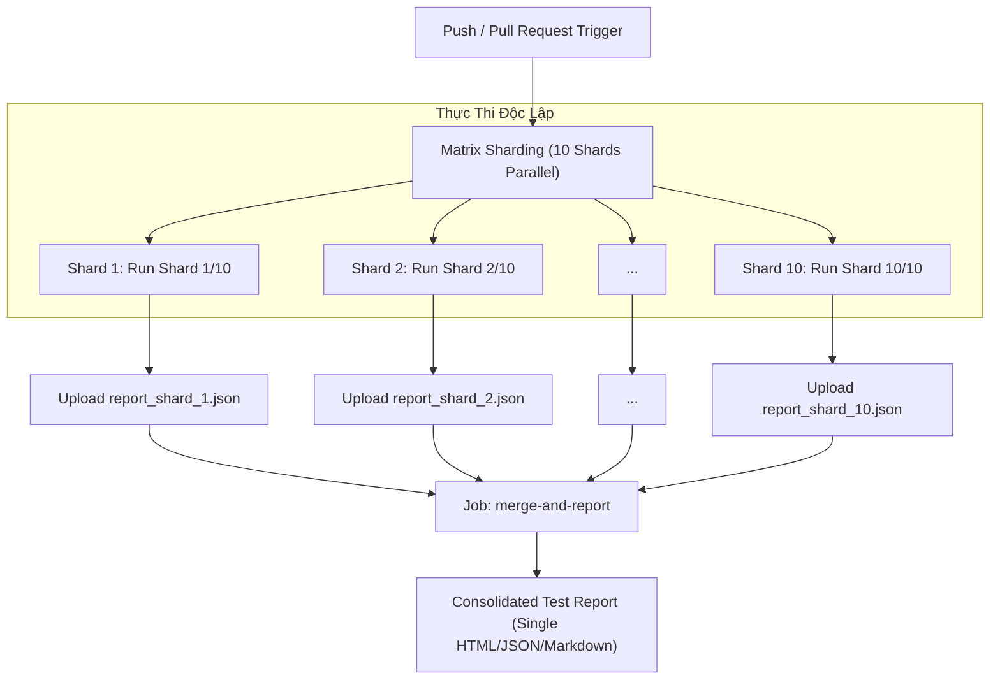

# Mobile Automation Mastery — Universal Framework Blueprint

> **Mục tiêu**: Cẩm nang và quy chuẩn kỹ thuật toàn diện đúc kết từ thực chiến, dùng làm kim chỉ nam để thiết kế, triển khai, debug và vận hành hệ thống Mobile Test Automation cho **mọi ứng dụng di động** (Android & iOS) ở quy mô công nghiệp.

---

## MỤC LỤC
1. [Kiến Trúc Framework Mẫu Cho Mọi Dự Án](#1-kiến-trúc-framework-mẫu-cho-mọi-dự-án)
2. [Chiến Lược Quản Lý Trạng Thái Ứng Dụng (Lifecycle & State Management)](#2-chiến-lược-quản-lý-trạng-thái-ứng-dụng-lifecycle--state-management)
3. [Quy Chuẩn Thiết Kế Test Flow Maestro Chống Flaky (Anti-Flaky Scripting)](#3-quy-chuẩn-thiết-kế-test-flow-maestro-chống-flaky-anti-flaky-scripting)
4. [Hệ Thống Kiểm Thử Hình Ảnh Thông Minh (Smart Visual Regression)](#4-hệ-thống-kiểm-thử-hình-ảnh-thông-minh-smart-visual-regression)
5. [Động Cơ Điều Phối Đa Thiết Bị Song Song (Multi-Device Parallel Engine)](#5-động-cơ-điều-phối-đa-thiết-bị-song-song-multi-device-parallel-engine)
6. [Tối Ưu Hóa Thiết Bị Thật vs Máy Ảo (Real Device vs Emulator)](#6-tối-ưu-hóa-thiết-bị-thật-vs-máy-ảo-real-device-vs-emulator)
7. [Mô Hình CI/CD Sharding & Khởi Tạo Máy Ảo Chuẩn (Enterprise CI/CD Pipelines)](#7-mô-hình-cicd-sharding--khởi-tạo-máy-ảo-chuẩn-enterprise-cicd-pipelines)
8. [Bảng Kiểm Tra Tiêu Chuẩn Hoàn Thành (Definition of Done Checklist)](#8-bảng-kiểm-tra-tiêu-chuẩn-hoàn-thành-definition-of-done-checklist)

---

## 1. KIẾN TRÚC FRAMEWORK MẪU CHO MỌI DỰ ÁN

Mọi dự án mobile app khi bắt đầu triển khai tự động hóa nên tổ chức thư mục theo cấu trúc 3 tầng phân tách độc lập (Separation of Concerns):

```text
<project-root>/
├── .maestro/                     # TẦNG 1: Kịch bản kiểm thử (Test Scripts)
│   ├── config/                   # Luồng dùng chung (Common/Reusable Flows)
│   │   ├── Init_First_Run.yaml   # Luồng Bootstrap vượt qua First-Run/Onboarding
│   │   ├── Launch_App.yaml       # Khởi động app an toàn (clearState: false)
│   │   ├── Close_Ads.yaml        # Xử lý đóng quảng cáo popup
│   │   └── Close_IAP.yaml        # Xử lý đóng popup thanh toán/In-App Purchase
│   ├── test-suite/               # Các luồng test chức năng chính (TC_01, TC_02...)
│   └── variations/               # Luồng test riêng theo biến thể (Free, Tablet, iOS...)
│
├── scripts/                      # TẦNG 2: Bộ máy Trí tuệ & Bổ trợ (Intelligence Layer)
│   ├── compare.py                # Thuật toán so sánh ảnh đa vùng (Multi-Zone + MAE)
│   ├── template_service.py       # Daemon OpenCV nhận diện đồ họa không có ID
│   └── merge_reports.py          # Script tổng hợp báo cáo từ nhiều máy/Shards
│
├── assets/                       # TẦNG 3: Dữ liệu mẫu & Baseline (Baseline Data)
│   ├── Base/                     # Ảnh baseline chuẩn mặc định
│   ├── Variant_A/                # Ảnh baseline riêng cho phiên bản A (VD: Premium)
│   └── Variant_B/                # Ảnh baseline riêng cho phiên bản B (VD: Free)
│
├── screenshots/                  # Ảnh chụp thực tế từ thiết bị (Runtime Artifacts)
├── reports/                      # Báo cáo JSON & Logs kết quả (Test Reports)
├── run_tests_windows.ps1         # Runner đơn máy (Windows)
├── run_parallel.ps1              # Runner song song đa thiết bị (Auto-Queue)
└── run_tests.sh                  # Runner môi trường Linux / CI/CD
```

---

## 2. CHIẾN LƯỢC QUẢN LÝ TRẠNG THÁI ỨNG DỤNG (LIFECYCLE & STATE MANAGEMENT)

Điểm yếu lớn nhất làm mobile test bị "flaky" (chập chờn) là **trôi dạt trạng thái (State Drift)**: máy mới cài app sẽ khác máy đã dùng lâu; tài khoản Free khác tài khoản VIP.

### 2.1. Quy Tắc Vàng Về Bảo Toàn Trạng Thái (Clear State Awareness)
* **KHÔNG tùy tiện dùng `clearState: true` trong các test case thông thường**: Lệnh này tương đương `pm clear`, sẽ xóa sạch Session, Token đăng nhập, mua hàng In-App và đưa app về lại màn hình chọn ngôn ngữ ban đầu.
* **Luôn bắt đầu test case bằng luồng khởi động an toàn**:
  ```yaml
  appId: com.example.app
  ---
  - runFlow: "../config/Launch_App.yaml"
  ```
  Trong đó `Launch_App.yaml` sử dụng `clearState: false` kèm cấp đủ quyền:
  ```yaml
  - launchApp:
      clearState: false
      permissions:
        all: allow
  ```

### 2.2. Mẫu Thiết Kế Vượt Rào First-Run (Solution 3: Bootstrap Flow)
Với môi trường CI/CD hoặc máy mới cài app, bắt buộc triển khai file `Init_First_Run.yaml` chạy một lần duy nhất trước toàn bộ test suite:
1. **Language**: Bắt sự kiện chọn ngôn ngữ mặc định (English) và bấm OK.
2. **Onboarding**: Lần lượt bấm `Next` qua toàn bộ màn hình giới thiệu cho đến nút `Get Started`.
3. **IAP & Ads**: Bắt và đóng màn hình mua gói cước dùng thử hoặc banner quảng cáo.
4. **Giải phóng Tooltip/Coachmarks**: Điều hướng vào sâu một tính năng bất kỳ, dùng lệnh lặp phím `back` từ 5–8 lần để đóng toàn bộ các bong bóng hướng dẫn (Intro tooltips).
5. **Relaunch an toàn**: Tắt app (`stopApp`) và mở lại (`launchApp`) để đưa app về màn hình Home sạch sẽ.

### 2.3. Bắt Popup Ngoại Lệ Đa Năng (Anti-Flaky Dynamic Popups)
Bọc các popup bất định (quảng cáo, thông báo cập nhật, xin đánh giá) trong khối điều kiện `when: visible`:
```yaml
- runFlow:
    when:
      visible:
        text: ".*(Rate Us|Enjoying the app|Update Now).*"
    commands:
      - tapOn: ".*(Later|Not now|Close|Maybe later).*"
```

---

## 3. QUY CHUẨN THIẾT KẾ TEST FLOW MAESTRO CHỐNG FLAKY

### 3.1. Phân Cấp Lựa Chọn Phần Tử (Selector Hierarchy)
Luôn tuân thủ thứ tự ưu tiên từ bền vững nhất đến linh hoạt nhất:
1. **Ưu tiên 1 (`id`)**: Dùng `resource-id` của Android hoặc `accessibilityIdentifier` của iOS (bất biến theo ngôn ngữ):
   ```yaml
   - tapOn:
       id: "btnSubmit"
   ```
2. **Ưu tiên 2 (`text` + Ngữ cảnh tương đối)**: Dùng khi ID bị trùng hoặc phần tử dạng text list:
   ```yaml
   - tapOn:
       id: "itemTitle"
       below:
         text: "Recent Projects"
   ```
3. **Ưu tiên 3 (`point: "x%, y%"`)**: Chỉ dùng khi tương tác trên vùng vẽ Canvas, Color Picker hoặc Webview không trích xuất được UI tree.

### 3.2. Cơ Chế Chờ Thông Minh (Smart Waits — Không dùng Hard Sleep)
* **Tuyệt đối tránh `sleep: 5000`** cứng vì gây lãng phí thời gian và dễ fail khi mạng chậm.
* **Thay thế bằng các lệnh chờ linh hoạt**:
  * `extendedWaitUntil`: Chờ phần tử xuất hiện/biến mất với trần timeout tối đa:
    ```yaml
    - extendedWaitUntil:
        visible:
          id: "mainContent"
        timeout: 15000
    ```
  * `waitForAnimationToEnd`: Chờ animation chuyển cảnh dừng hẳn trước khi click:
    ```yaml
    - waitForAnimationToEnd:
        timeout: 3000
    ```
  * `scrollUntilVisible`: Tự động cuộn danh sách cho đến khi tìm thấy item thay vì vuốt mù quáng nhiều lần.
  * `- hideKeyboard`: Luôn gọi lệnh này trước khi click các nút nằm ở nửa dưới màn hình để tránh bị bàn phím che khuất.

### 3.3. Quy Chuẩn Thoát Màn Hình An Toàn (Safe Exit Pattern)
Khi một test case hoàn tất và muốn trả trạng thái về Home Screen cho test case tiếp theo, hạn chế bấm chuỗi `Navigate up` nhiều lần (dễ bị kẹt Activity con). Hãy sử dụng mẫu thoát an toàn:
```yaml
- stopApp
- launchApp:
    clearState: false
    permissions:
      all: allow
- extendedWaitUntil:
    visible:
      id: "homeRootElement"
    timeout: 10000
```

### 3.4. Quy Chuẩn Đường Dẫn Tương Đối Trong Sub-Flows (Relative Path Invariance)
* Trong Maestro, mọi đường dẫn tương đối trong lệnh `runFlow:` được tính **từ vị trí của chính file YAML đang gọi nó**, KHÔNG PHẢI tính từ thư mục gốc dự án hay thư mục terminal đang đứng.
* **Quy tắc đếm cấp thư mục**:
  * File test nằm ở `.maestro/test-suite/TC_01.yaml`.
  * File common flow dùng chung nằm ở `.maestro/config/Close_Ads.yaml`.
  * Đường dẫn đúng là **lùi 1 cấp thư mục**: `../config/Close_Ads.yaml`.
  * Tuyệt đối tránh nhầm lẫn dùng `../../` (lùi 2 cấp sẽ trỏ ra ngoài thư mục gốc dự án `<root>/config/` và gây lỗi nghiêm trọng `Invalid File Path`).

### 3.5. Cơ Chế Selector Đa Hình Trong Ứng Dụng Multi-Flavor / White-Label (Polymorphic Selectors)
* **Vấn đề**: Trong các ứng dụng có nhiều biến thể (Free vs Premium, Brand A vs Brand B), thuộc tính phần tử UI thường xuyên bị thay đổi tiền tố/hậu tố (ví dụ: `mnItemSave` ở bản Free biến thành `mnItemSavePremium` ở bản Premium).
* **Giải pháp chuẩn**: Áp dụng biểu thức chính quy (Regex Pattern) trong selector Maestro để kịch bản tự động khớp cả hai phiên bản mà không cần viết điều kiện rẽ nhánh:
  ```yaml
  - assertVisible:
      id: ".*mnItemSave.*"
  - tapOn:
      id: ".*mnItemSave.*"
  ```

### 3.6. Xử Lý Tải Ảnh Bất Đồng Bộ Từ Mạng (Asynchronous Network Assets Loading)
* **Hiện tượng**: Khi chuyển màn hình hiển thị danh sách thẻ đồ họa tải từ internet (Glide/Picasso/Coil, ví dụ: Style Magic AI, Online Templates), lệnh `waitForAnimationToEnd` chỉ đợi animation mở Activity hoàn tất (~300ms) là kết thúc. Ảnh thumbnail mạng chưa kịp tải về, dẫn tới việc chụp phải các ô thẻ màu trắng trơn và bị fail visual so với baseline.
* **Giải pháp chuẩn**: Luôn thêm một khoảng trễ đồng bộ (synchronous delay 3–4s) bằng `evalScript` trước khi chụp ảnh:
  ```yaml
  - waitForAnimationToEnd:
      timeout: 20000
  - evalScript: ${var start = new Date().getTime(); while (new Date().getTime() < start + 3500); output.waited = true}
  - takeScreenshot: "screenshots/TC_{ID}_Style_Screen"
  ```

### 3.7. Chuẩn Hóa Thời Lượng Thao Tác Vuốt Kéo Tránh Flaky (Touch Digitizer Drag Duration)
* **Nguyên nhân Flaky**: Thời lượng vuốt `duration: 50` ms (0.05s) quá ngắn. Trên màn hình 60Hz, bộ số hóa cảm ứng (digitizer) coi đó là cử chỉ lướt nhanh bị hủy và không kéo di chuyển layer; nhưng trên màn hình 120Hz/240Hz (như Samsung S20 FE), cử chỉ được ghi nhận và kéo layer lệch sang góc khác, gây lệch Canvas nghiêm trọng.
* **Quy chuẩn**: Với các bài test kéo thả (Drag & Drop) hoặc di chuyển layer trên Canvas, bắt buộc dùng `duration` từ **`300` ms đến `500` ms** để cử chỉ ăn cảm ứng đồng nhất trên mọi phần cứng điện thoại. Nếu chỉ muốn chọn layer/kích hoạt thanh công cụ mà không xê dịch đối tượng, dùng `tapOn: point: "50%, 50%"`.

---

## 4. HỆ THỐNG KIỂM THỬ HÌNH ẢNH THÔNG MINH (SMART VISUAL REGRESSION)

Kiểm thử giao diện (Visual Testing) truyền thống thường gặp hai lỗi lớn: **False Positive** (lỗi bị che lấp bởi diện tích nền quá lớn) và **False Negative** (bị đánh rớt oan do lệch vài pixel ở vùng nền trơn).

### 4.1. Phân Tích Đa Vùng Động (Dynamic Multi-Zone Verification)
Chia màn hình thành các khu vực chức năng riêng biệt với các ngưỡng dung sai (threshold) phù hợp:
* **Vùng Nội dung Chính (Canvas / Body)** ($11\% \to 62\%$): Yêu cầu độ tương đồng cao $\ge 88\%$.
* **Vùng Điều khiển (Toolbar / Action Panel)** ($65\% \to 96\%$): Yêu cầu độ tương đồng $\ge 85\%$.

### 4.2. Xử Lý Bất Ổn Định Số Học Trên Nền Phẳng (Flat Color / Low Variance)
* **Bản chất toán học**: Thuật toán Pearson correlation (`cv2.TM_CCOEFF_NORMED`) chia cho độ lệch chuẩn $\sigma$. Khi một vùng là nền trắng/đen trơn ($\sigma \approx 0$), một vài pixel khử răng cưa hoặc viền hệ thống sẽ làm điểm số sụt giảm nghiêm trọng (ví dụ: tụt xuống $75.96\%$).
* **Giải pháp chuẩn**: Đo độ lệch chuẩn (`std`), nếu vùng ảnh là nền phẳng (`std < 8.0`), tự động chuyển sang đo khoảng cách màu trực tiếp bằng **Mean Absolute Error (MAE)**:
```python
def compute_zone_score(zone_act, zone_tpl):
    # Nếu vùng là nền phẳng/đơn sắc (std < 8.0), chuyển sang đo MAE
    if zone_act.std() < 8.0 or zone_tpl.std() < 8.0:
        mae = np.mean(np.abs(zone_act.astype(float) - zone_tpl.astype(float)))
        return max(0.0, 100.0 - (mae / 255.0) * 100.0)
    # Vùng có hoa văn/nút bấm chi tiết: dùng tương quan chuẩn hóa
    return cv2.matchTemplate(zone_act, zone_tpl, cv2.TM_CCOEFF_NORMED)[0][0] * 100.0
```

### 4.3. Loại Trừ Thanh Điều Hướng Hệ Thống (System UI Safe Insets & Gesture Navigation)
* **Status Bar & Navigation Bar Insets**: Luôn tự động cắt bỏ Status Bar ở trên cùng (top $4.5\%$) và Navigation Bar ở đáy (bottom $4\%$, $Y > 0.96h$).
* **Khả năng tương thích tuyệt đối giữa 3 nút điều hướng vs Cử chỉ vuốt (Gesture Navigation)**:
  * *Về mặt so sánh ảnh*: Thanh vạch cử chỉ (Gesture Pill) nằm sát mép đáy màn hình (ví dụ trên Samsung S20 FE 1080x2400 là từ $Y = 2360$ đến $2390$). Khoảng $4\%$ biên cắt an toàn ($Y > 2304$) loại bỏ hoàn toàn cả 3 phím cảm ứng lẫn vạch cử chỉ, đảm bảo ảnh so sánh visual không bao giờ bị fail oan khi người dùng đổi kiểu điều hướng.
  * *Về mặt kịch bản Maestro*: Lệnh `- back` của Maestro kích hoạt trực tiếp mã phím hệ điều hành (`adb shell input keyevent KEYCODE_BACK`) ở tầng Kernel/Window Manager, độc lập hoàn toàn với việc máy đang hiển thị nút bấm hay cử chỉ vuốt.

### 4.4. Cơ Chế Cập Nhật Baseline Tự Động (`-UpdateBaseline`)
Khi giao diện app có sự thay đổi thiết kế có chủ đích:
* Runner cung cấp cờ `-UpdateBaseline`:
  ```powershell
  .\run_tests_windows.ps1 -Folder "test-suite" -Version "Premium" -UpdateBaseline
  ```
* Hệ thống sẽ tự chụp ảnh runtime thực tế và copy ghi đè thành ảnh mẫu baseline mới trong thư mục `assets/`, tiết kiệm 100% thời gian crop và chụp ảnh thủ công.

### 4.5. Định Danh Ảnh Chụp Màn Hình Chống Xung Đột Song Song (Screenshot Isolation)
* Khi thực thi kiểm thử song song nhiều thiết bị hoặc nhiều Shards, mọi lệnh chụp ảnh bắt buộc phải có tiền tố mã Test Case:
  ```yaml
  - takeScreenshot: "screenshots/TC_{ID}_{Tên_Chức_Năng}"
  ```
* **Lý do**: Nếu dùng tên chung chung (như `screenshots/Verify_Edit_Screen`), các tiến trình chạy song song sẽ ghi đè đè lẫn nhau (race condition), dẫn đến kết quả so sánh hình ảnh visual bị sai lệch hoặc thiếu file.

### 4.6. Thích Ứng Mật Độ Điểm Ảnh & Chiều Cao Status Bar Đa Thiết Bị (Cross-DPI Adaptive Alignment)
* **Vấn đề lệch dọc (Vertical Status Bar Offset)**:
  * Baseline được chuẩn hóa theo thiết bị chuẩn 480dpi (Samsung Galaxy S20 FE, status bar $y \approx 96\text{px}$).
  * Khi chạy trên dòng máy khác (ví dụ: Google Pixel 6 420dpi, status bar $y \approx 132\text{px}$), vị trí toàn bộ khối Canvas và thanh công cụ bị dồn xuống dưới $20\text{–}36\text{px}$. Nếu so sánh cứng 1:1, ảnh sẽ bị đánh fail dù giao diện vẽ hoàn toàn chính xác.
* **Giải pháp kiến trúc**:
  1. **Sliding Window Search**: `scripts/compare.py` quét trượt theo trục $Y$ trong khoảng dung sai $\pm 20\text{–}30\text{px}$ để tìm vị trí khớp cực đại trước khi chấm điểm tương quan.
  2. **1:1 Fast-Path**: Giữ nguyên đường chạy nhanh không trượt cho các thiết bị cùng 480dpi (Samsung S20 FE và máy ảo CI/CD) để đạt tốc độ tối đa và kiểm tra pixel tuyệt đối.
  3. **Strict Sub-Band Pre-Check**: Thực hiện kiểm tra các dải khối Canvas cố định trước khi chuyển sang chế độ Sparse UI để không nhận nhầm các ô thẻ danh sách (như Mockup Preview cards) thành khoảng trống.

### 4.7. Khóa Cố Định Hướng Màn Hình & Dọn Dẹp Intent Chia Sẻ Hệ Thống (Orientation & Intent Hygiene)
* **Khóa xoay Portrait**:
  * Các màn hình đồ họa lớn (Preview, Mockup) rất dễ bị cảm biến tự động xoay ngang màn hình nếu thiết bị đặt trên bàn rung lắc.
  * Trước khi khởi động test suite, runner tự động ép cứng chiều dọc qua ADB:
    ```powershell
    adb shell "settings put system accelerometer_rotation 0"
    adb shell "settings put system user_rotation 0"
    ```
* **Dọn dẹp Intent Resolver**:
  * Màn hình chia sẻ ảnh của Android (`com.android.intentresolver`) có thể còn sót lại sau các bài test lưu ảnh. Runner tự động dọn dẹp trước khi chạy bài tiếp theo:
    ```powershell
    adb shell "am force-stop com.android.intentresolver"
    ```

---

## 5. ĐỘNG CƠ ĐIỀU PHỐI ĐA THIẾT BỊ SONG SONG (MULTI-DEVICE PARALLEL ENGINE)

### 5.1. Kiến Trúc Hàng Đợi Động (Work-Stealing Dynamic Task Queue)
* Thay vì chia cứng (máy A chạy bài 1-5, máy B chạy bài 6-10), runner triển khai một hàng đợi tập trung (`Queue<string>`).
* Khi một máy chạy xong test case của mình, nó lập tức lấy bài tiếp theo từ hàng đợi. Nhờ đó, bài test dài ngắn khác nhau vẫn tối ưu hóa $100\%$ thời gian CPU của mọi thiết bị.

### 5.2. Khởi Tạo Song Song Đồng Bộ (Parallel Bootstrap with Health Isolation)
* Khi khởi động test suite, toàn bộ $N$ thiết bị cùng lúc chạy `Init_First_Run.yaml` qua PowerShell `Start-Job`.
* **Cơ chế cách ly thiết bị lỗi**: Runner kiểm tra exit code của từng máy sau bước bootstrap. Nếu máy nào bị lỗi mạng hoặc kẹt popup, hệ thống sẽ tự động loại máy đó ra khỏi pool, chỉ cho phép các máy sẵn sàng nhận test case trong hàng đợi.

### 5.3. Máy Chủ Daemon OpenCV Đa Luồng (`ThreadingHTTPServer`)
* Khi test các thành phần đồ họa động (không có ID), các máy sẽ gọi API HTTP nội bộ tới port `8765`.
* Server bắt buộc phải là đa luồng (`ThreadingHTTPServer`) thay vì đơn luồng (`HTTPServer`). Nếu chạy đơn luồng, khi 5 đến 10 thiết bị cùng đồng loạt gửi request so khớp ảnh OpenCV, hàng đợi kết nối HTTP sẽ bị tắc nghẽn dẫn tới timeout hoặc ngắt kết nối socket.
* Dữ liệu ảnh chụp màn hình tạm thời phải cô lập theo serial thiết bị (`screen_temp_{serial}.png`) để nhiều máy cùng chụp và quét ảnh đồng thời mà không bị ghi đè file hoặc tranh chấp tài nguyên (race condition).

### 5.4. Chuẩn Hóa Chuyển Tiếp Tham Số Đa Nền Tảng (Cross-Shell CLI Forwarding: Bash vs PowerShell)
* **Bẫy tham số mảng giữa các Shell (Array Parameter Trap)**:
  * Khi gọi script PowerShell từ Linux/Bash trong pipeline CI/CD:
    ```bash
    bash run_tests.sh -Exclude "TC_00","TC_08"
    ```
  * Bash sẽ đóng gói toàn bộ cụm `"TC_00","TC_08"` thành **một chuỗi đơn duy nhất có chứa dấu phẩy**: `"TC_00,TC_08"`.
  * Khi chuyển tiếp vào `pwsh -File ./run_tests_windows.ps1 "$@"`, biến `$Exclude` trong PowerShell nhận mảng có 1 phần tử: `@("TC_00,TC_08")`.
  * Nếu runner chỉ kiểm tra `$testFile.Name -like "*$_*"`, nó sẽ so khớp tên file với cả cụm `"TC_00,TC_08"`. Kết quả là `TC_00` không khớp và **KHÔNG ĐƯỢC BỎ QUA**, dẫn tới việc test case bị chạy ngoài ý muốn trên CI.
* **Giải pháp chuẩn hóa trong Runner**:
  * Tại phần khởi tạo của runner PowerShell, luôn có bước chuẩn hóa tự động tách chuỗi bằng dấu phẩy:
    ```powershell
    $normalizedExclude = @()
    foreach ($item in $Exclude) {
        if ($item) {
            $parts = $item -split ',' | ForEach-Object { $_.Trim() } | Where-Object { $_ -ne "" }
            $normalizedExclude += $parts
        }
    }
    $Exclude = $normalizedExclude
    ```

---

## 6. TỐI ƯU HÓA THIẾT BỊ THẬT VS MÁY ẢO (REAL DEVICE VS EMULATOR)

| Tiêu Chí | Thiết Bị Thật (Physical Device) | Máy Ảo Giả Lập (Emulator / CI) |
| :--- | :--- | :--- |
| **Animation Scale** | **BẮT BUỘC GIỮ $1\times$** để máy luôn mượt mà 60/120Hz tự nhiên cho người dùng | Có thể tắt (`scale 0`) để tiết kiệm CPU trên server headless |
| **Độ Sáng & Nguồn** | Bật `svc power stayon true` để không tắt màn hình khi cắm cáp USB | Tự động giữ màn hình qua cờ `-no-window` hoặc setting |
| **Màn Hình Khóa** | **Tắt mã PIN/Mật khẩu**, chuyển sang chế độ vuốt hoặc không khóa | Tự động bypass keyguard qua ADB |
| **Dọn Session** | Tự động xóa `$HOME\.maestro\sessions` trước mỗi đợt chạy để tránh kẹt cổng ADB | Mỗi worker chạy trên 1 container cô lập hoàn toàn |
| **Đồng Bộ Dữ Liệu Test** | Tự động push ảnh mẫu vào `/sdcard/Pictures/` và phát broadcast quét Gallery | Tự động mount ổ đĩa test |

---

## 7. MÔ HÌNH CI/CD SHARDING & KHỞI TẠO MÁY ẢO CHUẨN (ENTERPRISE CI/CD PIPELINES)

Đối với các dự án lớn có hàng chục hoặc hàng trăm test case, chạy tuần tự trên CI sẽ mất nhiều giờ. Áp dụng kiến trúc **Matrix Sharding song song kết hợp điều phối máy ảo**:

### 7.1. Kiến Trúc Sharding Song Song (Matrix Jobs)



* **Quy trình chuẩn**:
  1. **Khởi tạo máy ảo chuẩn**: Tạo emulator khớp $100\%$ độ phân giải (`1080x2400 @ 480dpi`) và OS version với máy thật tham chiếu.
  2. **Chuyển đổi Bundle AAB sang APK**: Sử dụng `bundletool` kết hợp `debug.keystore` để cài đặt tự động.
  3. **Chạy Bootstrap Flow**: Cả 10 Shard đều chạy vượt rào First-Run trước khi phân chia test case.
  4. **Thu thập Artifact & Báo cáo Tập trung**: Dùng `scripts/merge_reports.py` để gộp toàn bộ kết quả thành một bản tổng hợp duy nhất hiển thị trực quan trên GitHub Actions Summary.

### 7.2. Golden Workflow Template Cho Android Emulator CI/CD (GitHub Actions)
Khởi chạy Android Emulator (đặc biệt các phiên bản mới như Android 13 API 33+) trên GitHub Actions hosted runner (`ubuntu-latest`: 2 vCPUs, 7 GB RAM, ~14 GB đĩa trống) thường xuyên bị lỗi nếu không tối ưu tài nguyên. Dưới đây là cấu hình chuẩn hóa (Production-Ready Workflow):

```yaml
jobs:
  maestro-shard-test:
    runs-on: ubuntu-latest
    strategy:
      fail-fast: false
      matrix:
        shardIndex: [1, 2, 3, 4, 5, 6, 7, 8, 9, 10]
        shardTotal: [10]
    steps:
      - name: Checkout Code
        uses: actions/checkout@v4

      # BƯỚC 1: Giải phóng >15GB đĩa để QEMU tạo userdata không bị tràn ổ cứng
      - name: Free Disk Space for Android Emulator
        run: |
          sudo rm -rf /usr/share/dotnet
          sudo rm -rf /opt/ghc
          sudo rm -rf /usr/local/share/boost
          sudo rm -rf "$ANDROID_SDK_ROOT/ndk" || true
          df -h

      # BƯỚC 2: Cấp quyền phần cứng KVM (Hardware Acceleration)
      - name: Enable KVM group perms
        run: |
          echo 'KERNEL=="kvm", GROUP="kvm", MODE="0666", OPTIONS+="static_node=kvm"' | sudo tee /etc/udev/rules.d/99-kvm4all.rules
          sudo udevadm control --reload-rules
          sudo udevadm trigger --name-match=kvm
          ls -la /dev/kvm || true

      - name: Set up JDK 17
        uses: actions/setup-java@v4
        with:
          java-version: '17'
          distribution: 'temurin'

      - name: Set up Python
        uses: actions/setup-python@v5
        with:
          python-version: '3.11'

      - name: Install Python Dependencies & Maestro CLI
        run: |
          pip install opencv-python-headless numpy pillow requests
          curl -Ls "https://get.maestro.mobile.dev" | bash
          echo "$HOME/.maestro/bin" >> $GITHUB_PATH

      # BƯỚC 3: Khởi tạo Android Emulator với thông số cân bằng tài nguyên
      - name: Run Maestro Tests on Emulator (Shard ${{ matrix.shardIndex }}/10)
        uses: ReactiveCircus/android-emulator-runner@v2
        with:
          api-level: 33
          target: google_apis
          arch: x86_64
          profile: pixel_6
          ram-size: 2048M             # KHÔNG vượt quá 2048M-2560M để tránh OOM Killer
          heap-size: 512M
          disk-size: 4096M            # Đảm bảo đủ dung lượng chứa OS + APK + Media
          force-avd-creation: true
          emulator-options: -no-window -no-snapshot -noaudio -no-boot-anim -camera-back none -gpu swiftshader_indirect
          emulator-boot-timeout: 900  # 15 phút chống timeout khi runner chia sẻ CPU
          disable-animations: true
          script: |
            # Chuẩn hóa resolution theo thiết bị thật Samsung S20 FE
            adb shell wm size 1080x2400 || true
            adb shell wm density 480 || true
            bash run_tests.sh -Folder "test-suite" -ShardIndex ${{ matrix.shardIndex }} -ShardTotal ${{ matrix.shardTotal }}
```

### 7.3. Cẩm Nang Chẩn Đoán & Khắc Phục Sự Cố Máy Ảo CI/CD (CI Troubleshooting Matrix)

| Triệu chứng lỗi (Symptoms) | Nguyên nhân gốc rễ (Root Cause) | Giải pháp xử lý triệt để (Remedy) |
| :--- | :--- | :--- |
| `Error: Timeout waiting for emulator to boot.` kèm `device 'emulator-5554' not found` | **1. Tràn RAM (OOM Killer)**: Cấp `ram-size: 4096M` trên runner 7GB khiến QEMU bị Linux OOM killer tiêu diệt ngầm.<br>**2. Cạn đĩa**: Runner hết dung lượng khi tạo partition.<br>**3. Kẹt Snapshot**: Cờ `-no-snapshot-save` cố đọc snapshot bị lỗi. | 1. Hạ `ram-size: 2048M`.<br>2. Thêm bước `Free Disk Space` xóa dotnet/ghc/boost/ndk.<br>3. Đổi sang cờ `-no-snapshot` (buộc cold-boot sạch).<br>4. Tăng `emulator-boot-timeout: 900`. |
| `FATAL: Not enough space` hoặc `No space left on device` | Image Android API 33 (~4GB giải nén) + Userdata (4GB) làm đầy ổ đĩa mặc định của GitHub runner. | Chạy lệnh giải phóng đĩa (`sudo rm -rf /usr/share/dotnet...`) giải phóng ngay ~15GB trước khi gọi action máy ảo. |
| Máy ảo khởi động cực chậm (> 15 phút) | Runner không bật được KVM hardware virtualization, QEMU phải chạy ở chế độ Software Emulation. | Cấp quyền udev rule cho `/dev/kvm` (`chmod 666 /dev/kvm`). |
| Ảnh Visual Regression bị lệch nút hoặc co giãn trên CI | Máy ảo khởi tạo profile mặc định (vd: 1080x1920 @ 420dpi) khác với máy thật tham chiếu (1080x2400 @ 480dpi). | Bắt buộc chạy 2 lệnh chuẩn hóa ngay sau khi emulator online:<br>`adb shell wm size 1080x2400`<br>`adb shell wm density 480`. |
| App bị văng (Crash) khi chạy trên emulator CI | Bản build APK là ARM (armeabi-v7a / arm64-v8a) nhưng emulator là kiến trúc `x86_64` mà thiếu NDK translation. | Khi dùng `bundletool`, luôn chỉ định cờ `--mode=universal` hoặc tạo AVD hỗ trợ ABI tương thích. |
| `Launch app "<appId>"... FAILED` kèm `Package is not installed` | Máy ảo CI là môi trường mới tinh chưa có sẵn app. Thư mục `app/` trên Git trống và chưa có release nào trên GitHub Releases. | Áp dụng cơ chế **Fail-Fast**: Kiểm tra `adb shell pm list packages` trước khi chạy test; Đính kèm APK vào GitHub Releases hoặc lưu trữ tại `app/*.apk`. |
| `Invalid File Path at .../TC_*.yaml` | Đường dẫn `runFlow:` tính từ vị trí file YAML hiện tại bị thừa cấp thư mục (ví dụ dùng `../../config/` thay vì `../config/`). | Đếm đúng cấp thư mục: từ `.maestro/test-suite/` sang `.maestro/config/` chỉ lùi đúng 1 cấp `../config/`. |

### 7.4. Chiến Lược Cung Cấp Bản Build Ứng Dụng (APK/AAB Provisioning & Fail-Fast)
Khác với thiết bị thật đã cài sẵn app từ trước, máy ảo Android trên CI/CD được tạo mới sạch sẽ (clean environment). Do đó, runner bắt buộc phải có chiến lược nạp bản build rõ ràng:

1. **Chiến lược 1 — GitHub Releases Assets (Khuyến nghị chuẩn Enterprise)**:
   * Giữ kho git gọn nhẹ, không commit file binary APK nặng (>50MB).
   * Tạo GitHub Release trên repository (ví dụ tag `v1.0.0`) và đính kèm `Logo_Maker.apk`.
   * Script CI tự động truy vấn API GitHub (`https://api.github.com/repos/<owner>/<repo>/releases/latest`) bằng `GH_TOKEN`, tải file binary về và thực hiện `adb install -r -g`.
2. **Chiến lược 2 — Bundletool AAB sang Universal APK**:
   * Nếu app xuất xưởng dưới dạng Android App Bundle (`.aab`), CI tự động tải `bundletool.jar`, tạo keystore debug tạm thời và trích xuất `universal.apk` tương thích với mọi kiến trúc CPU của emulator.
3. **Cơ chế Thất Bại Sớm (Fail-Fast Diagnostic)**:
   * Trước khi khởi động Maestro test suite, bắt buộc chạy kiểm tra gói cài đặt:
     ```bash
     if ! adb shell pm list packages | grep -q "$APP_ID"; then
       echo "[ERROR] Package $APP_ID not found on device!"
       echo "Please upload APK to GitHub Releases or put it into app/ before running CI tests."
       exit 1
     fi
     ```
   * Dừng script ngay lập tức (`exit 1`) nếu app chưa được cài, tránh tình trạng hàng chục Shard chạy mù quáng và đồng loạt báo lỗi `Package not installed`.

### 7.5. Quản Trị Hạn Mức Lưu Trữ Artifacts (Actions Storage Quota & Retention Policy)
* **Vấn đề**: Tài khoản GitHub cá nhân chỉ có 500 MB lưu trữ Actions miễn phí mỗi tháng. Khi pipeline chạy song song 10 máy ảo (10 Shards), mỗi máy chụp hàng chục ảnh visual regression và đẩy lên artifact với retention mặc định là 90 ngày (hoặc 7 ngày), dung lượng 500 MB sẽ bị lấp đầy chỉ sau vài đợt push commit.
* **Quy chuẩn thiết lập**:
  * Luôn cấu hình tham số `retention-days: 1` hoặc `retention-days: 2` trong bước `actions/upload-artifact@v4` đối với các kịch bản ma trận song song:
    ```yaml
    - name: Upload Shard Test Results
      if: always()
      uses: actions/upload-artifact@v4
      with:
        name: shard-result-${{ matrix.shardIndex }}
        path: |
          reports/
          screenshots/
        retention-days: 1
    ```
  * Sau khi job tổng hợp `merge-and-report` chạy xong và xuất Markdown trực tiếp vào phần Summary của GitHub Actions, các ảnh chụp riêng lẻ của từng Shard chỉ cần lưu lại tối đa 24h để phục vụ debug rồi tự động bị xóa, giúp dung lượng tài khoản luôn duy trì ở mức an toàn (< 50MB).

---

## 8. BẢNG KIỂM TRA TIÊU CHUẨN HOÀN THÀNH (DEFINITION OF DONE CHECKLIST)

Mỗi khi xây dựng hoặc bảo trì một kịch bản kiểm thử mới cho bất kỳ ứng dụng di động nào, hãy đối chiếu với checklist sau:

- [ ] **Header rõ ràng**: Khai báo đúng `appId`, mục tiêu kiểm thử và tài liệu tham chiếu ở đầu file.
- [ ] **Khởi động an toàn**: Luôn gọi common flow `Launch_App.yaml` (`clearState: false`), không hardcode reset app bừa bãi.
- [ ] **Kháng Flaky**: Toàn bộ popup ngoại lệ (quảng cáo, IAP, quyền hệ thống) đều được bọc trong `when: visible`.
- [ ] **Selector chuẩn**: Ưu tiên tuyệt đối dùng `id` và `text` có ngữ cảnh, chỉ dùng toạ độ `point` cho vùng vẽ tự do.
- [ ] **Không Hard Sleep**: Sử dụng `extendedWaitUntil` hoặc `waitForAnimationToEnd`.
- [ ] **Đăng ký Visual Test**: Đặt tên ảnh chụp nhất quán, đăng ký đầy đủ vào Runner Map và kiểm thử tương thích cả nền phẳng với `compute_zone_score`.
- [ ] **Thoát an toàn**: Đảm bảo sau khi test xong, màn hình trở về trạng thái sạch sẽ cho test case tiếp theo.
- [ ] **Đường dẫn sub-flow chuẩn xác**: Đếm đúng cấp thư mục khi gọi `runFlow` (ví dụ từ `test-suite/` sang `config/` là `../config/...`), loại bỏ hoàn toàn nguy cơ `Invalid File Path`.
- [ ] **Chạy thử thực tế**: Kịch bản chạy thực tế trên thiết bị/máy ảo đạt trạng thái **PASSED 100%**.
- [ ] **Sẵn sàng cho CI/CD**: Cấu hình emulator trên CI runner tuân thủ: đã dọn dẹp đĩa trống, RAM $\le 2048M$, dùng cờ `-no-snapshot`, boot timeout $\ge 900s$ và có chiến lược cấp APK rõ ràng.

---

## 9. MƯỜI TRỤ CỘT KỸ THUẬT CỐT LÕI & CÁC BÀI HỌC THỰC CHIẾN (THE 10 ENGINEERING PILLARS)

Bộ 10 bài học kỹ thuật thực chiến đúc kết từ quá trình hiện thực hóa hệ thống kiểm thử Logo Maker:

### 9.1. Cơ chế RecyclerView & Trôi Index (View Recycling & Computer Vision Matching)
* **Bản chất**: Trong RecyclerView của Android, khi cuộn danh sách (ví dụ: Category "Food & Drink"), chỉ có khoảng 4-6 ViewHolder được nạp trong bộ nhớ và liên tục được tái sử dụng để hiển thị dữ liệu mới. Thuộc tính `index: 0` hay `index: 5` bị thay đổi thực thể hiển thị sau mỗi thao tác cuộn.
* **Quy chuẩn kiến trúc**: Tuyệt đối không dùng `index` cố định khi chọn template trong RecyclerView động. Sử dụng giải pháp Hybrid Computer Vision:
  - Khởi động daemon HTTP nội bộ (`scripts/template_service.py` trên cổng 8765) dùng OpenCV đa luồng.
  - Sử dụng ảnh template mục tiêu (`assets/template_restaurant.png`) quét toàn màn hình bằng `cv2.matchTemplate(..., cv2.TM_CCOEFF_NORMED)`.
  - Tap thẳng vào tâm tọa độ $(x + w/2, y + h/2)$ của kết quả khớp cao nhất ($R \ge 0.70$).

### 9.2. Tọa độ thao tác phần cứng (ADB Gestures & "Vết chạm chết" $x = 540$)
* **Bản chất**: Trên màn hình tỉ lệ 20:9 độ phân giải $1080 \times 2400$, giao diện hiển thị 2 cột template. Đường trục dọc $x = 540$ là khe phân cách tĩnh (gutter/divider). Khi lệnh ADB phát ra tọa độ `input swipe 540 ...`, điểm chạm rơi vào vùng không thuộc ViewHolder nào, khiến hệ điều hành không kích hoạt sự kiện cuộn dẫn đến màn hình bị kẹt (`stuck_count`).
* **Quy chuẩn**:
  - Tuyệt đối tránh tọa độ ranh giới cột. Luôn vuốt theo tỉ lệ lệch sang cột 1: $x = \text{screen\_w} \times 0.30$.
  - Kéo vuốt trong khoảng an toàn $y \in [50\%, 20\%]$ để tránh va chạm vào banner quảng cáo ở đáy hoặc toolbar trên đỉnh.
  - Bổ sung cơ chế tự phục hồi: Khi phát hiện 2 lần cuộn liên tiếp tọa độ không đổi (`stuck_count >= 2`), tự động chạm điểm an toàn $x = 75\%, y = 70\%$ để đóng overlay che phủ trước khi cuộn tiếp.

### 9.3. Mạng ảo Android Emulator trên CI (netsim & DNS)
* **Bản chất**: Khi chạy giả lập Android trên môi trường Linux Headless (GitHub Actions Runner), module mạng ảo `netsim` mặc định bị nghẽn phân giải DNS nội bộ, làm app không tải được dữ liệu và ảnh mẫu từ CDN máy chủ.
* **Quy chuẩn**: Bắt buộc cấu hình cờ khởi động emulator trong workflow:
  ```yaml
  emulator-options: -no-window -no-snapshot -noaudio -no-boot-anim -camera-back none -gpu swiftshader_indirect -dns-server 8.8.8.8 -netdelay none -netspeed full
  ```
  kèm `disable-animations: true` để mở toàn bộ băng thông mạng và vô hiệu hóa animation chuyển cảnh.

### 9.4. Tải ảnh bất đồng bộ (Glide/CDN) & Điểm số OpenCV rơi vào ~0.32
* **Bản chất**: Khi mạng internet tải chậm hoặc app vừa cài mới, thư viện Glide chưa kịp nạp ảnh về đĩa, RecyclerView chỉ hiển thị các khung xám placeholder. Khi OpenCV quét tìm template mẫu màu trên khung xám, điểm tương quan chỉ đạt $R \approx 0.30 - 0.35$ (dưới ngưỡng chấp nhận $0.70$).
* **Quy chuẩn**:
  - Chờ popup tải tài nguyên kết thúc: `extendedWaitUntil: notVisible: "Downloading resources", timeout: 30000`.
  - Chèn bước trễ đồng bộ 3.5s (`evalScript` với while loop timestamp) trước khi chụp ảnh để Glide nạp đủ thumbnail từ mạng.

### 9.5. Hiệu ứng Domino & Phân tích nguyên nhân gốc (RCA: TC_01 vs TC_03 → TC_14)
* **Bản chất**: `TC_01` pass vì chỉ tương tác ở Home Screen. Các bài từ `TC_03` đến `TC_14` đều gọi chung luồng `Navigate_To_Restaurant_Edit.yaml`. Khi bước OpenCV trước đó không tìm thấy template do mạng lag hoặc kẹt scroll, app vẫn ở màn Category chứ chưa bao giờ vào Edit Screen. Do đó, bước assertion `assertVisible: "Logos4U"` ở màn sau bị fail dây chuyền.
* **Bài học RCA**: Không debug đơn lẻ tại bước báo lỗi trên report (`"Logos4U"`), luôn phân tích ngược chuỗi hành động để tìm điểm gãy thực sự ở các sub-flow tiền đề.

### 9.6. Xử lý Popup bất đồng bộ (Delayed IAP/Ads & Self-Healing 8 màn Intro)
* **Bản chất**: Quảng cáo xen kẽ và popup IAP thường được nạp ngầm và bật lên trễ sau 6 đến 8 giây kể từ khi mở màn hình. Đồng thời, khi mở Edit Screen lần đầu, app hiển thị liên tiếp 8 bong bóng hướng dẫn (Intro tooltips).
* **Quy chuẩn Self-Healing**:
  - Áp dụng cơ chế giải phóng bong bóng hướng dẫn tự phục hồi:
    ```yaml
    - repeat:
        times: 8
        while:
          notVisible:
            id: "mnItemSave"
        commands:
          - back
          - waitForAnimationToEnd:
              timeout: 800
    ```
  - Bọc toàn bộ popup ngoại lệ trong khối điều kiện `when: visible: "Close"`.

### 9.7. Bẫy dung lượng lưu trữ (Storage Quota) trên GitHub Actions
* **Bản chất**: Chạy song song 10 Shards, mỗi máy chụp hàng chục ảnh PNG $1080 \times 2400$. Tổng dung lượng artifacts dễ dàng vượt quá hạn ngạch 500MB miễn phí của GitHub Actions, gây ngắt pipeline.
* **Quy chuẩn**:
  - Cấu hình `retention-days: 1` trong bước `upload-artifact` để tự động dọn ảnh chụp sau 24h.
  - Sử dụng `scripts/merge_reports.py` gộp 10 file JSON báo cáo thành 1 bảng tóm tắt Markdown gọn nhẹ (~5KB) gắn trực tiếp vào `$GITHUB_STEP_SUMMARY`, vừa theo dõi tức thì vừa không chiếm hạn ngạch lưu trữ.

### 9.8. Điều phối Đa Thiết Bị Song Song (Multi-Device Parallelism) & Tranh Chấp File Lock trên Windows
* **Bản chất**: Maestro CLI trên hệ điều hành Windows lưu trữ thông tin phiên làm việc tại `$HOME/.maestro/sessions`. Khi PowerShell chạy song song nhiều Worker (`Start-Job`) cùng một mili-giây, tiến trình Java thứ hai sẽ bị từ chối truy cập do cơ chế khóa file độc quyền của Windows (`java.io.IOException: The process cannot access the file because another process has locked a portion of the file`), làm Worker bị hủy ngay tại bước bootstrap.
* **Quy chuẩn Stagger Launch**: Thêm độ trễ kích hoạt 3 giây (`Start-Sleep -Seconds 3`) giữa các lần `Start-Job` trong runner `run_parallel.ps1`. Khoảng trễ này đảm bảo tiến trình Maestro đầu tiên mở session và bind socket an toàn trước khi tiến trình tiếp theo khởi tạo.

### 9.9. Cạn Kiệt Ổ Đĩa Host (%TEMP% APK Exhaustion) & Cơ Chế Phục Hồi Thất Bại Thông Minh (-Resume)
* **Bản chất**: Mỗi lần Maestro CLI thực thi kịch bản, nó tự động giải nén `maestro-server.apk` vào thư mục tạm `%USERPROFILE%\AppData\Local\Temp` dưới dạng `tmp*.apk` (~40MB/file). Sau hàng trăm lần chạy, hàng trăm file tạm tích tụ nuốt chửng 10GB đến 20+ GB khiến ổ đĩa C: rơi vào tình trạng 0.0 GB Free (`java.io.IOException: There is not enough space on the disk`), làm tất cả các test case sau đó đồng loạt FAILED sau 2-4 giây.
* **Quy chuẩn Tự động Dọn Rác & Smart Resume**:
  - Tự động xóa sạch `*tmp*.apk` và các file `*.tmp` rác trong `%TEMP%` ở cả đầu và cuối chu trình chạy của runner `run_parallel.ps1`.
  - Cung cấp tham số `-Resume`: Khi chuỗi test bị gián đoạn do sự cố ngoại cảnh, runner đọc lại `reports/parallel_local/report_*.json`. Các test case đã `PASSED` ở phiên trước sẽ được tự động giữ nguyên và bỏ qua không chạy lại; chỉ những test chưa chạy hoặc bị `FAILED` mới được đưa vào hàng đợi (`$queue`) để phân bổ cho các Worker rảnh, tiết kiệm hàng chục phút kiểm thử lặp lại vô ích.

### 9.10. Visual Regression Đa Mật Độ Điểm Ảnh (Cross-DPI / Cross-Device Normalization)
* **Bản chất**: Các thiết bị Android thực tế có mật độ hiển thị khác nhau (ví dụ: Google Pixel 6 chạy ở 420dpi, Samsung Galaxy S20 FE chạy ở 480dpi) dù cùng độ phân giải vật lý $1080 \times 2400$. Hệ thống layout và kích thước icon/tool zone trên 420dpi sẽ nhỏ hơn so với 480dpi theo tỉ lệ $420 / 480 = 0.875$.
* **Quy chuẩn Multi-Scale Normalization**:
  - Thuật toán `scripts/compare.py` sử dụng tập tỉ lệ candidate DPI scales ($0.875, 1.0, 1.143$) kết hợp bù trừ Status Bar offset và đánh giá vùng cục bộ (`_score_tool_zone_cross_dpi`), giúp bộ ảnh mẫu Baseline chụp trên thiết bị 480dpi vẫn so khớp đạt tỉ lệ tuyệt đối (90% – 100%) khi thực thi trên thiết bị 420dpi mà không cần phải chụp lại bộ baseline riêng cho từng dòng máy.

### 9.11. Lỗi Mã Hóa Ký Tự Đầu Ra Trên Windows (`UnicodeEncodeError: 'charmap'` trong Python Daemon)
* **Bản chất**: Khi Python daemon chạy ngầm trên Windows (như `template_service.py`) và redirect stdout/stderr ra file log bằng PowerShell (`Start-Process -RedirectStandardOutput ...`), Python mặc định chọn bảng mã OEM của hệ thống (`cp1252`). Nếu script in chuỗi log có dấu tiếng Việt (ví dụ `Chờ ảnh tải qua mạng`), Python lập tức văng `UnicodeEncodeError: 'charmap' codec can't encode character '\u1edd'` và làm crash HTTP daemon ở port 8765. Hậu quả là toàn bộ test suite gọi daemon OpenCV đều bị đứt kết nối và FAILED đồng loạt ngay bước điều hướng.
* **Quy chuẩn Phòng Ngừa & Xử Lý**:
  - Toàn bộ log trong các script daemon ngầm bắt buộc dùng tiếng Anh chuẩn ASCII.
  - Luôn đặt đoạn mã ép UTF-8 ở đầu script: `if hasattr(sys.stdout, 'reconfigure'): sys.stdout.reconfigure(encoding='utf-8', errors='replace')`.
  - Trong các PowerShell runner (`run_tests_windows.ps1`, `run_parallel.ps1`), luôn truyền cờ `-X utf8` khi gọi `Start-Process $PythonCmd -ArgumentList "-X utf8 scripts/template_service.py"`.

### 9.12. Bẫy Hạn Ngạch CI/CD GitHub Actions & Chiến Lược Sharding vs Self-Hosted
* **Bản chất**: Pipeline chạy song song 10 Shards trên đám mây GitHub (`maestro-shard-test` với Android Emulator QEMU x86_64) tiêu hao ~250 phút Actions cho mỗi lần push. Trên tài khoản cá nhân/private repo, hạn mức 2.000 phút miễn phí sẽ bị cạn sạch chỉ sau 8 lần push, dẫn đến lỗi toàn bộ job bị hủy lập tức: `The job was not started because recent account payments have failed or your spending limit needs to be increased`.
* **Quy chuẩn Quản Trị Hạn Ngạch**:
  - Không để trigger tự động `push`/`pull_request` chạy 10 shards liên tục trên các nhánh feature. Chuyển sang kích hoạt thủ công bằng `workflow_dispatch`.
  - Cấu hình nâng hạn mức chi tiêu `Spending limits` trên GitHub Billing nếu cần chạy cloud runner.
  - Chuyển đổi runner sang `runs-on: self-hosted` để tận dụng máy thật nội bộ không bị giới hạn phút và không mất chi phí.

### 9.13. Quy Trình Di Chuyển Repository Sạch (Zero-History Orphan Branch Migration)
* **Bản chất**: Khi cần chuyển giao toàn bộ thành quả automation từ một tài khoản/tổ chức cũ sang tài khoản cá nhân độc lập mà không được để lộ lịch sử commit, tác giả cũ hoặc dính líu đến repository URL cũ.
* **Quy chuẩn Di Chuyển Sạch**:
  - Sử dụng kỹ thuật Orphan Branch: `git checkout --orphan clean-main`.
  - Khử toàn bộ hardcoded repo name trong các file script (`run_tests.sh`, config).
  - Tạo 1 root commit duy nhất mang tên tác giả cá nhân: `git commit -m "Initial commit: Maestro Automation Framework"`.
  - Đẩy lên remote mới: `git push -u origin clean-main:main`.
  - Cắt toàn bộ tracking cũ: `git fetch --prune origin` và dọn dẹp các nhánh local cũ bằng `git branch -D`.

### 9.14. Cạm Bẫy Tự Động Nhận Diện Phiên Bản (Auto-Detect App Version) Theo Tên Nhánh Git
* **Bản chất**: Khi runner auto-detect phiên bản ứng dụng (`Free` vs `Premium`) dựa trên tên nhánh git: `if ($gitBranch -match "premium") { $resolvedVersion = "Premium" } else { $resolvedVersion = "Free" }`. Khi dự án chuyển sang nhánh chính (`main`, `master`, hoặc `develop`), tên nhánh không chứa từ khóa `"premium"`. Runner tự động fallback về `Free`.
* **Hậu quả**:
  - Truyền nhầm tham số `-e APP_VERSION=Free` vào Maestro, kích hoạt các nhánh logic dành riêng cho bản Free thay vì Premium.
  - Runner so sánh ảnh chụp màn hình với thư mục `assets/Free/` thay vì `assets/Premium/`, dẫn đến toàn bộ bài test Premium bị fail hoặc sai lệch logic so khớp ảnh.
* **Quy chuẩn**:
  - Trong CI/CD pipeline (`maestro_local.yml`), luôn truyền tường minh tham số `-Version "Premium"`.
  - Tuyệt đối không phó mặc cho cơ chế auto-detect theo tên nhánh khi thực thi bộ test suite chính trên nhánh `main`.

### 9.15. Chiến Lược Cân Bằng Hạn Ngạch CI/CD Sharding (5 Shards vs 10 Shards Trade-off)
* **Bản chất**: Chạy song song 10 Shards máy ảo trên GitHub Actions tiêu tốn ~250 phút Actions cho mỗi lần push. Trên tài khoản cá nhân với private repo, hạn mức 2.000 phút/tháng sẽ bị cạn kiệt chỉ sau 8 lần chạy.
* **Quy chuẩn Điểm Cân Bằng Vàng (5 Shards)**:
  - Cấu hình 5 Shards là tỉ lệ tối ưu cho bộ test 14-16 test cases: mỗi Shard chạy 2-3 test case trong khoảng 8-12 phút.
  - Cắt giảm ngay lập tức **50% số phút tiêu thụ**, kéo dài thời gian sử dụng hạn ngạch hàng tháng gấp đôi.
  - Thời gian chờ kết quả tổng thể (wall-clock time) gần như không đổi vì phần lớn thời gian chạy của runner CI bị chiếm bởi overhead khởi tạo máy ảo QEMU/Android Emulator (3-5 phút boot ban đầu).

### 9.16. Kiến Trúc Tự Động Quay Video Màn Hình Android (`adb shell screenrecord`) & Cạm Bẫy `--time-limit`
* **Bản chất**: Để hỗ trợ debug trực quan và ghi lại bằng chứng khi test case bị FAILED, hệ thống runner tích hợp khả năng tự động quay video màn hình ngầm qua ADB `screenrecord` ở độ phân giải gốc $1080 \times 2400$.
* **Cạm bẫy Native Android Time Limit**: Lệnh `screenrecord` của Android có giới hạn cứng tham số `--time-limit` trong khoảng `[1, 180]` (tối đa 180 giây = 3 phút). Nếu truyền `--time-limit 1800` (hoặc bất kỳ giá trị nào > 180), tiến trình sẽ crash ngay tức khắc khi khởi động với thông báo lỗi `Time limit 1800s outside acceptable range [1,180]`, dẫn đến không có video nào được tạo.
  - *Quy chuẩn*: Luôn đặt tham số `--time-limit 180` (hoặc để mặc định 180s) kết hợp `--bit-rate 4000000` (4 Mbps) để cân bằng giữa độ nét sắc sảo và dung lượng file siêu nhẹ (~5-15MB/test).
* **Cơ chế đóng container MP4 an toàn (Graceful SIGINT Termination)**: Khác với ảnh PNG, định dạng MP4 bắt buộc phải ghi khối dữ liệu `moov atom` (chứa index, metadata và duration) vào đuôi file khi kết thúc. Nếu dừng tiến trình bằng force kill (`kill -9` hoặc ngắt process `adb` từ Windows đột ngột), file MP4 sẽ bị hỏng hoàn toàn (corrupt container) và không mở được. Đồng thời lệnh `pkill -2 screenrecord` trên một số dòng máy (Samsung) có thể bị từ chối quyền `Operation not permitted`.
  - *Quy chuẩn dừng an toàn*:
    ```powershell
    adb -s $env:ANDROID_SERIAL shell "kill -2 `$(pidof screenrecord 2>/dev/null)" 2>&1 | Out-Null
    Start-Sleep -Seconds 2
    if ($videoProc -and (-not $videoProc.HasExited)) {
        Stop-Process -Id $videoProc.Id -Force -ErrorAction SilentlyContinue
    }
    Start-Sleep -Seconds 1
    adb -s $env:ANDROID_SERIAL pull $deviceVideoPath $localVideoFile
    ```

### 9.17. Quản Lý Vòng Đời Video Artifacts Trên CI/CD (GitHub Actions vs Local)
* **Chiến lược `-RecordOnlyOnFailure`**: Trên GitHub Actions chỉ lưu video khi bài test FAILED. Nếu bài test PASSED, runner lập tức xóa video trên thiết bị (`rm -f $deviceVideoPath`) và không kéo về máy host, giúp tiết kiệm 100% dung lượng kéo file và lưu trữ Artifacts.
* **Cơ chế lưu trữ trên GitHub Actions**: Mỗi Workflow Run được cấp một Run ID riêng biệt với môi trường máy ảo sạch (Clean VM). Video lỗi được nén trong gói Artifact của từng Run ID, **hoàn toàn không bị ghi đè** giữa các lần build khác nhau (có thể xem lại lịch sử video của các commit trước trong thời hạn retention).
* **Khác biệt trên máy Local**: Trên máy tính cá nhân, runner lưu video theo tên bài test `reports/videos/<test>.mp4`, lần chạy sau sẽ tự động **ghi đè** lên lần chạy trước để bảo vệ dung lượng ổ cứng.

### 9.18. Cạm Bẫy Nhận Diện Nút Save Trên Edit Screen Giữa Các Bản Quyền (`mnItemSave` vs `mnItemSavePremium`)
* **Bản chất**: Trên màn hình thiết kế (Edit Screen), resource-id của nút Lưu thay đổi động tùy theo trạng thái bản quyền của mẫu thiết kế:
  - Nếu mở mẫu thiết kế Free: Nút lưu có id là `com.thmobile.logomaker:id/mnItemSave`.
  - Nếu mở mẫu thiết kế Premium (có icon vương miện PRO): Nút lưu có id là `com.thmobile.logomaker:id/mnItemSavePremium`.
* **Hậu quả**: Nếu script test assert cứng `id: "mnItemSave"` thì khi chạy trên template Premium, Maestro sẽ báo lỗi `Element not found: id: mnItemSave` và đánh rớt test case oan uổng.
* **Quy chuẩn**: Trong mọi kịch bản Maestro, khi kiểm tra hoặc chạm vào nút Save trên Edit Screen, **bắt buộc dùng Regex**:
  ```yaml
  - assertVisible:
      id: ".*mnItemSave.*"
  ```

### 9.19. Chuẩn Hóa Lọc Danh Sách Test Phân Tách Dấu Phẩy Cho PowerShell Runner
* **Bản chất**: Khi cần chạy linh hoạt một nhóm test case (ví dụ chạy nhanh từ `TC_01` đến `TC_05`), tham số `$File` mặc định chỉ chấp nhận một chuỗi so khớp đơn (`-notlike "*$File*"`).
* **Quy chuẩn**: Chuẩn hóa `$filterFiles = $File -split ',' | ForEach-Object { $_.Trim() } | Where-Object { $_ -ne "" }`, cho phép truyền lệnh dạng `-File "TC_01,TC_02,TC_03,TC_04,TC_05"` ở cả runner đơn và runner song song.


