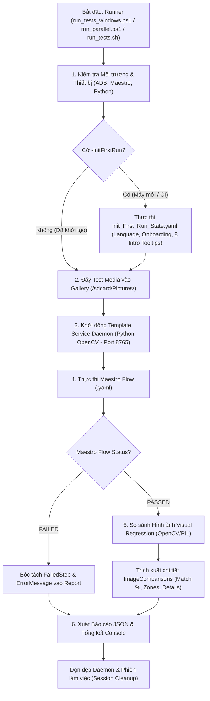

# 🎨 Logo Maker - Mobile Automation Testing (Android)

> **Hệ thống Kiểm thử Tự động E2E & Visual Regression Đa nền tảng dành cho ứng dụng Android Logo Maker (`com.thmobile.logomaker`)**  
> Xây dựng dựa trên **Maestro Framework**, **ADB**, **Python OpenCV Computer Vision**, **PowerShell Orchestrator** và **GitHub Actions CI/CD (10 Shards Parallel)**.

---

## 📑 Mục lục
1. [Tổng quan Kiến trúc Hệ thống](#-tong-quan-kien-truc-he-thong)
2. [Điểm Đột phá Kỹ thuật](#-diem-dot-pha-ky-thuat)
3. [Cấu trúc Thư mục Dự án](#-cau-truc-thu-muc-du-an)
4. [Danh mục Kịch bản Kiểm thử](#-danh-muc-kich-ban-kiem-thu)
5. [Cài đặt Môi trường (Prerequisites)](#-cai-dat-moi-truong-prerequisites)
6. [Hướng dẫn Thực thi Lệnh (Execution Guide)](#-huong-dan-thuc-thi-lenh-execution-guide)
7. [Tích hợp CI/CD GitHub Actions (10 Devices Parallel)](#-tich-hop-cicd-github-actions-10-devices-parallel)
8. [Hệ thống Báo cáo Kiểm thử (Rich JSON Reporting)](#-he-thong-bao-cao-kiem-thu-rich-json-reporting)
9. [Cẩm nang Xử lý Sự cố (Troubleshooting FAQ)](#-cam-nang-xu-ly-su-co-troubleshooting-faq)

---

## 🏛 1. Tổng quan Kiến trúc Hệ thống

Dự án được thiết kế theo mô hình **Hybrid Automation (E2E Functional Flow + Computer Vision Regression)** kết hợp với cơ chế điều phối thông minh:



### Thông số Môi trường Tiêu chuẩn:
- **Application ID**: `com.thmobile.logomaker`
- **Môi trường Thiết bị Mục tiêu**: Samsung Galaxy S20 FE (Android 13, 1080x2400 @ 480dpi) / Android Emulator API 33 (Google APIs x86_64).
- **Hệ điều hành Điều phối**: Windows 11 (PowerShell Terminal) / Linux (Ubuntu Runner trên GitHub Actions).

---

## ⚡ 2. Điểm Đột phá Kỹ thuật

### 🌟 2.1. Bootstrap Setup Flow cho Thiết bị Mới (Solution 3)
- **Vấn đề**: Khi app vừa cài đặt trên máy ảo mới của GitHub Actions hoặc sau khi Clear Data, ứng dụng luôn bị chặn bởi màn **Language**, 3 màn **Onboarding**, popup **IAP/Trial**, và **8 tooltip Intro** trên Edit Screen.
- **Giải pháp**: Xây dựng [`.maestro/config/Init_First_Run_State.yaml`](file:///d:/logo-maker/.maestro/config/Init_First_Run_State.yaml) kết hợp với cờ `-InitFirstRun`. Flow này tự động hoàn tất toàn bộ quy trình tiền khởi tạo chỉ trong 1 lần chạy, sau đó dùng `stopApp` và `launchApp: clearState: false` để đưa thiết bị về trạng thái **Home Screen** sạch sẽ, lưu trạng thái vĩnh viễn cho toàn bộ test suite.

### 👁 2.2. Template Service Daemon (Port 8765)
- Tự động nhận diện và chọn mẫu thiết kế nhà hàng trên Canvas RecyclerView không có `resource-id` bằng thuật toán đối sánh mẫu đa tỷ lệ (**Multi-scale Template Matching**).
- Giao tiếp mượt mà với Maestro thông qua script trung gian [`select_premium_template.js`](file:///d:/logo-maker/scripts/select_premium_template.js).

### 🔍 2.3. Dynamic Multi-Zone Visual Compare
- Sử dụng thuật toán so sánh chia vùng thông minh trong [`scripts/compare.py`](file:///d:/logo-maker/scripts/compare.py) và [`scripts/compare_screens.py`](file:///d:/logo-maker/scripts/compare_screens.py).
- Loại trừ các vùng động (thanh trạng thái pin, đồng hồ hệ thống, quảng cáo AdMob) để chống tình trạng **False Negative** và **Flaky Test**.

### 🔄 2.4. Đa Phiên bản Baseline (Multi-Version Fallback)
- Hỗ trợ độc lập 2 phiên bản: **Free** và **Premium** (`-Version "Premium"` hoặc `-Version "Free"`).
- Khi chạy bản Premium, hệ thống ưu tiên tìm ảnh mẫu trong [`assets/Premium/`](file:///d:/logo-maker/assets/Premium/). Nếu không có, tự động fallback về [`assets/`](file:///d:/logo-maker/assets/) chung.

### 🏷 2.5. Cơ chế Selector Đa Hình (Polymorphic Selectors)
- Khắc phục sự phân hóa thuộc tính UI giữa hai phiên bản ứng dụng: Nút Lưu góc trên bên phải màn hình Edit có ID `mnItemSave` ở bản Free, nhưng tự động chuyển thành `mnItemSavePremium` ở bản Premium.
- Áp dụng biểu thức chính quy (Regex Pattern) `id: ".*mnItemSave.*"` giúp kịch bản test tự động tương thích và thực thi xuyên suốt trên cả hai môi trường mà không cần phân nhánh code.

---

## 📂 3. Cấu trúc Thư mục Dự án

```text
logo-maker/
├── .github/
│   └── workflows/
│       └── maestro_local.yml     # Workflow CI/CD chạy 10 Shards máy ảo song song
├── .maestro/
│   ├── config/                   # Flow khởi tạo & tiện ích dùng chung
│   │   ├── Init_First_Run_State.yaml      # Bootstrap Setup cho máy mới (Solution 3)
│   │   ├── Launch_App.yaml                # Khởi động app an toàn
│   │   ├── Navigate_To_Restaurant_Edit.yaml # Điều hướng vào Edit Screen & OpenCV Select
│   │   ├── Close_Ads_Screen.yaml          # Xử lý đóng quảng cáo
│   │   └── Close_IAP_Screen.yaml          # Xử lý đóng màn hình thanh toán
│   ├── test-suite/               # 16 Kịch bản kiểm thử tính năng cốt lõi (TC_00 -> TC_14)
│   └── free-version/             # Kịch bản kiểm thử độc lập dành riêng cho bản Free
├── assets/                       # Ảnh mẫu chuẩn Baseline
│   ├── Premium/                  # Ảnh mẫu đặc thù cho gói Premium
│   └── Free/                     # Ảnh mẫu đặc thù cho bản Free
├── docs/                         # Tài liệu hướng dẫn & chuyển giao hệ thống
│   ├── AUTOMATION_TRANSFER_GUIDE.md       # Cẩm nang chuyển giao chi tiết từ A-Z
│   ├── REPORT_ASSETS_PREMIUM_COMPARISON.md # Phân tích đối sánh Visual Baseline
│   └── test-cases/                        # Đặc tả ca kiểm thử gốc (Mockup, Edit Screen, Home...)
│       ├── Mockup_Preview_Screen_TestCases.txt # Bộ 12 test cases chi tiết cho tính năng Mockup
│       └── ...
├── reports/                      # Báo cáo kết quả kiểm thử JSON & log runtime
├── screenshots/                  # Ảnh chụp màn hình từ thiết bị trong quá trình test
│   └── debug/                    # Ảnh chụp màn hình tạm phục vụ chẩn đoán lỗi
├── scripts/                      # Bộ công cụ bổ trợ kiểm thử
│   ├── compare.py                # So sánh hình ảnh OpenCV Multi-zone
│   ├── compare_screens.py        # So sánh 2 ảnh chụp runtime (Dual Compare)
│   ├── merge_reports.py          # Script tổng hợp báo cáo từ nhiều máy ảo/shards
│   ├── select_premium_template.py # Backend OpenCV tìm template
│   ├── select_premium_template.js # Cầu nối HTTP gọi từ Maestro
│   └── template_service.py       # Daemon server HTTP port 8765
├── run_tests_windows.ps1         # Test Runner chính thức trên Windows (Hỗ trợ Sharding)
├── run_parallel.ps1              # Runner chạy song song nhiều thiết bị Local
├── run_tests.sh                  # Runner chính thức trên Linux / CI
├── AGENTS.md                     # Quy tắc và chuẩn mực hoạt động của AI Agent
└── README.md                     # Tài liệu tổng quan dự án (File này)
```

---

## 📋 4. Danh mục Kịch bản Kiểm thử (`test-suite`)

| Mã Test Case | Tên Kịch Bản | Mục Tiêu Kiểm Thử |
| :--- | :--- | :--- |
| **TC_00** | `TC_00_Get_Payment_Flow` | Kiểm thử màn hình thanh toán IAP, các gói cước (Tuần, Năm), tính năng dùng thử và nút đóng mua hàng |
| **TC_01** | `TC_01_Verify_Navigated_to_Edit_Screen_By_Select_Category_On_Home_Screen` | Điều hướng Home -> Danh mục -> Edit Screen & xác thực Toolbar/BottomBar |
| **TC_02** | `TC_02_Test_Background_Tool_On_Edit_Screen` | Kiểm thử công cụ Nền: Màu sắc, Gradient, Hình học, Độ trong suốt |
| **TC_03** | `TC_03_Test_Art_Tool_On_Edit_Screen` | Kiểm thử công cụ Đồ họa (Art): Điều hướng, Controls, Thao tác Layer |
| **TC_04** | `TC_04_Test_Sub_Tab_Color_Art_Tool_On_Edit_Screen` | Kiểm thử Tab Color của Art: Đổi màu đơn sắc, Opacity, so sánh visual |
| **TC_05** | `TC_05_Test_Sub_Outline_Art_Tool_On_Edit_Screen` | Kiểm thử Tab Outline của Art: Đổi màu viền, độ dày viền |
| **TC_06** | `TC_06_Test_Sub_3D_Art_Tool_On_Edit_Screen` | Kiểm thử tính năng xoay 3D (Trục X, Y, Z) của đối tượng Art |
| **TC_07** | `TC_07_Test_Text_Tool_On_Edit_Screen` | Kiểm thử nhập chữ mới, chỉnh Font chữ, kích thước Text |
| **TC_08** | `TC_08_Test_Home_Screen` | Kiểm thử toàn diện màn hình chính Home Screen: Header, Banner, các danh mục và điều hướng |
| **TC_08.1**| `TC_08_Test_Sub_Control_Text_Tool_On_Edit_Screen` | Kiểm thử Controls của Text: Dịch chuyển, Đổi layer, Duplicate |
| **TC_09** | `TC_09_Test_Sub_Tabs_Text_Tool_On_Edit_Screen` | Kiểm thử toàn diện 14 sub-tabs Text: Spacing, Shadow, Gradient, 3D, Curve |
| **TC_10** | `TC_10_Test_Preview_Screen` | Kiểm thử màn hình xem trước Logo, chia sẻ, lưu Draft và Mockup |
| **TC_11** | `TC_11_Test_Mockup_Preview_Screen` | Kiểm thử toàn diện Mockup Preview (Brand Identify): Lưu Mockup có/không Watermark, chuyển nút Save sang Share, duyệt 5 Mockup, điều hướng 2 chiều từ Template và từ My Logo |
| **TC_12** | `TC_12_Test_Generate_AI_On_Style_Magic_AI_Screen` | Kiểm thử tính năng tạo logo AI từ Prompt và bộ Style Preset |
| **TC_13** | `TC_13_Test_Feature_Usage_And_Save_On_Edit_Screen` | Kiểm thử luồng chỉnh sửa liên hoàn 6 công cụ và lưu ảnh HD ra Gallery |
| **TC_14** | `TC_14_Test_Background_Sub_Features_And_Save_On_Edit_Screen` | Kiểm thử chuyên sâu các tính năng con của Background và xuất file |

---

## 🛠 5. Cài đặt Môi trường (Prerequisites)

### 1. Công cụ Yêu cầu
- **Hệ điều hành**: Windows 11 (PowerShell 7 khuyến nghị) hoặc macOS / Linux.
- **Android SDK & ADB**: Đã thêm vào biến môi trường `PATH`.
- **Java JDK**: Phiên bản 17 (Temurin / OpenJDK).
- **Python**: Phiên bản 3.10 trở lên (`py --version`).
- **Maestro CLI**:
  ```powershell
  # Windows (qua PowerShell / Curl)
  curl -Ls "https://get.maestro.mobile.dev" | bash
  ```

### 2. Cài đặt thư viện Python
```powershell
py -m pip install --upgrade pip
py -m pip install opencv-python numpy pillow requests
```

---

## 🚀 6. Hướng dẫn Thực thi Lệnh (Execution Guide)

### 6.1. Chạy trên Windows (PowerShell Runner - `run_tests_windows.ps1`)

#### Chạy 1 Test Case cụ thể (Bản Premium):
```powershell
.\run_tests_windows.ps1 -File "TC_01_Verify_Navigated_to_Edit_Screen_By_Select_Category_On_Home_Screen.yaml" -Version "Premium"
```

#### Chỉ định Serial thiết bị cụ thể (khi cắm nhiều điện thoại hoặc máy ảo):
```powershell
.\run_tests_windows.ps1 -File "TC_11_Test_Mockup_Preview_Screen.yaml" -Device "R3CNA099XKL" -Version "Premium"
```

#### Chạy toàn bộ thư mục `test-suite` kèm Khởi tạo lần đầu (`-InitFirstRun`):
```powershell
.\run_tests_windows.ps1 -Folder "test-suite" -Version "Premium" -InitFirstRun -Exclude "TC_00,TC_08_Test_Home_Screen"
```

#### Chạy phân chia Shard thủ công trên máy cục bộ (`-ShardIndex`, `-ShardTotal`):
```powershell
# Chạy nhóm 1 trong tổng số 2 nhóm test cases:
.\run_tests_windows.ps1 -Folder "test-suite" -ShardIndex 1 -ShardTotal 2 -Version "Premium"
```

#### Tự động chụp và Cập nhật Ảnh mẫu Chuẩn (Update Baseline):
```powershell
.\run_tests_windows.ps1 -File "TC_04_Test_Sub_Tab_Color_Art_Tool_On_Edit_Screen.yaml" -Version "Premium" -UpdateBaseline
```

#### Xuất báo cáo JSON ra vị trí tùy biến (`-ReportJson`):
```powershell
.\run_tests_windows.ps1 -File "TC_11_Test_Mockup_Preview_Screen.yaml" -ReportJson "reports/custom_test_report.json" -Version "Premium"
```

---

### 6.2. Chạy Song song Nhiều Thiết bị Local (`run_parallel.ps1`)

Runner song song tự động phát hiện tất cả các thiết bị kết nối qua `adb devices` (thiết bị thật lẫn máy ảo Android) và điều phối công việc qua hàng đợi động (Auto-Queue Worker Pattern).

#### 1. Chạy mới toàn bộ Test Suite (Loại trừ `TC_00` thanh toán và `TC_08_Home`):
```powershell
.\run_parallel.ps1 -Folder "test-suite" -Version "Premium" -Exclude "TC_00,TC_08_Test_Home_Screen"
```

#### 2. Tiếp tục chạy khi bị ngắt quãng / đứt chuỗi (Chế độ Resume - Khuyên Dùng):
> [!TIP]
> Cờ `-Resume` tự động kiểm tra thư mục báo cáo, **bảo lưu toàn bộ kết quả của các test case đã PASSED trước đó** (không chạy lại tốn thời gian), chỉ đưa các test case còn dở dang hoặc FAILED vào hàng đợi để các máy tiếp tục xử lý. Kết hợp với `-SkipInit` để bỏ qua bước onboarding nếu máy đã ở sẵn Home Screen:
```powershell
.\run_parallel.ps1 -Folder "test-suite" -Version "Premium" -Exclude "TC_00,TC_08_Test_Home_Screen" -SkipInit -Resume
```

#### 3. Chỉ định danh sách thiết bị cụ thể tham gia kiểm thử:
```powershell
# Chạy trên 2 thiết bị xác định (Pixel 6 và Samsung S20 FE):
.\run_parallel.ps1 -Devices "24271FDF6009EZ,R3CNA099XKL" -Folder "test-suite" -Version "Premium" -Exclude "TC_00,TC_08_Test_Home_Screen" -SkipInit -Resume
```

#### 4. Chạy 1 test case cụ thể trên thiết bị rảnh:
```powershell
.\run_parallel.ps1 -File "TC_03_Test_Art_Tool_On_Edit_Screen" -Version "Premium" -SkipInit
```

#### 5. Bảng tra cứu toàn bộ tham số của `run_parallel.ps1`:
| Tham số | Kiểu dữ liệu | Mặc định | Ý nghĩa & Mô tả chi tiết |
|:---|:---:|:---:|:---|
| `-Folder` | `string` | `"test-suite"` | Thư mục chứa kịch bản kiểm thử cần chạy (`test-suite` hoặc `free-version`). |
| `-Version` | `string` | `"Auto"` | Phiên bản app (`Premium`, `Free`, hoặc `Auto` tự động bắt theo git branch). |
| `-Devices` | `string[]` | `@()` | Danh sách serial thiết bị (nếu để trống, tự động nhận diện tất cả máy từ `adb devices`). |
| `-Exclude` | `string[]` | `TC_00, TC_08_Home` | Danh sách test case loại trừ (hỗ trợ cả dạng mảng hoặc chuỗi ngăn cách bởi dấu phẩy). |
| `-File` | `string` | `""` | Lọc chạy duy nhất 1 test case cụ thể theo tên file. |
| `-MaxDevices` | `int` | `10` | Số lượng thiết bị tối đa tham gia chạy song song. |
| `-InitFirstRun` | `switch` | `$true` | Tự động chạy bootstrap (`Init_First_Run_State.yaml`) vượt màn onboarding/IAP. |
| `-SkipInit` | `switch` | `$false` | Bỏ qua bootstrap nếu các thiết bị đã ở sẵn màn hình Home. |
| `-Resume` | `switch` | `$false` | **(Mới)** Tiếp tục chạy các test case chưa hoàn thành / failed, giữ nguyên test đã PASS. |

#### 6. Các cơ chế tự động bảo vệ tích hợp sẵn trong Runner:
- **Tự động dọn rác `%TEMP%`**: Quét và xóa sạch các file tạm `tmp*.apk` do Maestro giải nén trước và sau khi chạy, triệt tiêu nguy cơ cạn kiệt ổ đĩa C:.
- **Giãn cách Stagger 3 giây**: Khi điều phối việc sang nhiều máy, runner tự giãn cách $3$ giây giữa các tiến trình để triệt tiêu lỗi đụng độ file lock `$HOME/.maestro/sessions` trên Windows.
- **Tự động hợp nhất báo cáo**: Sau khi toàn bộ test hoàn tất, runner tự động kích hoạt `scripts/merge_reports.py` xuất bảng Markdown và file tổng hợp `reports/parallel_local/consolidated_report.json`.

---

### 6.3. Chạy trên Linux / macOS / WSL (`run_tests.sh`)

Script [`run_tests.sh`](file:///d:/logo-maker/run_tests.sh) đã cấu hình sẵn cho các môi trường UNIX, tự động cấu hình độ phân giải 1080x2400 @ 480dpi và chuyển tiếp tham số vào runner:
```bash
chmod +x run_tests.sh

# Chạy toàn bộ test suite cơ bản:
./run_tests.sh -Folder "test-suite" -Version "Premium"

# Chạy 1 test case cụ thể:
./run_tests.sh -File "TC_11_Test_Mockup_Preview_Screen.yaml" -Version "Premium"
```

---

### 6.4. Debug Trực tiếp bằng Maestro CLI (Native Debugging)

Khi muốn chạy và xem trực tiếp log từng dòng của Maestro CLI mà không qua wrapper runner:
```powershell
# Bước 1: Khởi động OpenCV Template Service daemon (Port 8765) nếu kịch bản cần chọn template
Start-Process py -ArgumentList "scripts/template_service.py"

# Bước 2: Chạy trực tiếp qua Maestro CLI
maestro --device R3CNA099XKL test .maestro/test-suite/TC_11_Test_Mockup_Preview_Screen.yaml
```

---

### 6.5. Công cụ Hỗ trợ & Chẩn đoán Lỗi Nhanh (Utilities & Diagnostics)

#### So sánh ảnh độc lập bằng Python (Không cần chạy lại toàn bộ test):
```powershell
# So sánh ảnh chụp runtime với ảnh mẫu baseline:
py scripts/compare.py . assets/Premium/TC_11_Verify_Navigated_To_Mockup_Preview_Screen.png none screenshots/TC_11_Verify_Navigated_To_Mockup_Preview_Screen

# So sánh 2 ảnh chụp runtime (Dual Compare - xem tính năng đổi màu/nền):
py scripts/compare.py . dual screenshots/TC_02_Color_Picker_White none screenshots/TC_02_Canvas_Background_After_Color_White none
```

#### Tổng hợp báo cáo JSON từ nhiều Shards thành Markdown:
```powershell
py scripts/merge_reports.py reports reports/FINAL_SUMMARY.md
```

#### Xuất cây giao diện XML (UI Hierarchy Dump) từ thiết bị thật:
```powershell
adb shell uiautomator dump /sdcard/uidump.xml
adb pull /sdcard/uidump.xml ui-dumps/current_ui_dump.xml
```

#### Khôi phục gói cài đặt ứng dụng khi bị uninstalled cho user 0:
```powershell
adb shell cmd package install-existing --user 0 com.thmobile.logomaker
```

---

## ☁ 7. Tích hợp CI/CD GitHub Actions (10 Devices Parallel)

Dự án đã tích hợp sẵn pipeline tự động tại [`.github/workflows/maestro_local.yml`](file:///d:/logo-maker/.github/workflows/maestro_local.yml):

- **Số lượng máy ảo**: **10 máy ảo Android độc lập (10 Shards Parallel)** chạy cùng lúc trên 10 Runner Ubuntu.
- **Mỗi máy ảo phụ trách**: 1 đến 2 test case từ hàng đợi đã được phân chia theo chỉ số Shard (`${{ matrix.shardIndex }}/10`).
- **Thời gian hoàn tất**: Toàn bộ test suite hoàn thành chỉ sau **3 - 5 phút**.
- **Tổng hợp báo cáo tập trung**: Job `merge-and-report` tự động tải các artifact JSON từ 10 máy ảo về và gọi [`scripts/merge_reports.py`](file:///d:/logo-maker/scripts/merge_reports.py) để xuất bảng báo cáo Markdown trực quan trong phần GitHub Actions Summary.

> [!TIP]
> **Quản lý Hạn mức Lưu trữ Artifacts (Actions Storage Quota)**:
> Mỗi tài khoản GitHub cá nhân có sẵn 500 MB lưu trữ Actions miễn phí. Do workflow chạy song song 10 Shards và tải lên toàn bộ ảnh chụp màn hình, tham số `retention-days: 2` (hoặc `1`) được khuyến nghị trong bước `actions/upload-artifact` để tự động dọn dẹp các artifact cũ, tránh chạm ngưỡng cảnh báo 90% quota hàng tháng.

---

## 📊 8. Hệ thống Báo cáo Kiểm thử (Rich JSON Reporting)

Mỗi lần chạy kiểm thử, hệ thống tự động sinh báo cáo JSON chi tiết tại thư mục `reports/`:

```json
{
  "TestFile": "TC_04_Test_Sub_Tab_Color_Art_Tool_On_Edit_Screen.yaml",
  "Status": "PASSED",
  "DurationSeconds": 115.4,
  "FailedStep": null,
  "ErrorMessage": null,
  "ImageComparisons": [
    {
      "Template": "assets/Premium/Color_SubTab_Default.png",
      "Screenshot": "screenshots/Color_SubTab_Default.png",
      "Status": "PASSED",
      "MatchPercentage": 99.4,
      "Zones": "Multi-Zone Verified",
      "Details": "Matched 99.4% (Threshold: 90%)"
    }
  ]
}
```

- **Khi có lỗi**: Bóc tách chính xác vị trí câu lệnh bị fail (`FailedStep`) và chi tiết nguyên nhân từ Maestro log (`ErrorMessage`).
- **So sánh hình ảnh**: Thống kê danh sách đầy đủ toàn bộ các ảnh chụp runtime kèm tỷ lệ % khớp so với mẫu chuẩn.

---

## ❓ 9. Cẩm nang Xử lý Sự cố (Troubleshooting FAQ)

### 1. Lỗi "Failed to connect to device / Session lock"
- **Nguyên nhân**: Maestro bị kẹt file khóa session trên Windows do bị dừng đột ngột.
- **Khắc phục**:
  ```powershell
  Remove-Item "$HOME\.maestro\sessions" -Recurse -Force -ErrorAction SilentlyContinue
  ```

### 2. Lỗi "Device offline / ADB not found"
- **Khắc phục**:
  ```powershell
  adb kill-server
  adb start-server
  adb devices
  ```

### 3. Template Service daemon (Port 8765) bị kẹt process
- **Khắc phục**:
  ```powershell
  Get-Process | Where-Object { $_.ProcessName -like "*python*" } | Stop-Process -Force
  ```

### 4. Popup "Downloading resources" khi mở template lần đầu
- Trong flow điều hướng [`.maestro/config/Navigate_To_Restaurant_Edit.yaml`](file:///d:/logo-maker/.maestro/config/Navigate_To_Restaurant_Edit.yaml), hệ thống đã bổ sung bước tự động click `Download in background` và đợi dialog biến mất trước khi assert `Logos4U`.

### 5. Sự phân hóa ID nút Lưu trên Edit Screen (Free vs Premium)
- **Hiện tượng**: Kịch bản báo lỗi `Element not found: Id matching regex: mnItemSave`.
- **Nguyên nhân**: Trên phiên bản Premium hoặc khi mở template Premium, nút Lưu đổi `resource-id` thành `mnItemSavePremium` (thay vì `mnItemSave` như bản Free).
- **Khắc phục**: Luôn sử dụng regex pattern `id: ".*mnItemSave.*"` trong assertion hoặc lệnh `tapOn` để tương thích 100% với cả hai phiên bản.

### 6. Lỗi "There is not enough space on the disk" (Đầy ổ C: do %TEMP%)
- **Hiện tượng**: Tất cả các test case đồng loạt bị FAILED chỉ sau 2–4 giây thực thi kèm lỗi `java.io.IOException: There is not enough space on the disk`.
- **Nguyên nhân**: Maestro CLI tự động giải nén `maestro-server.apk` vào thư mục tạm `%USERPROFILE%\AppData\Local\Temp` dưới dạng file `tmp*.apk`. Qua hàng trăm lần chạy, các file này tích tụ chiếm 10GB–20GB làm đầy ổ đĩa C:.
- **Khắc phục**: Runner `run_parallel.ps1` đã tích hợp tự động dọn rác. Nếu muốn dọn thủ công ngay lập tức bằng PowerShell:
  ```powershell
  $temp = [System.IO.Path]::GetTempPath()
  Get-ChildItem -Path $temp -Filter "*tmp*.apk" | Remove-Item -Force
  Get-ChildItem -Path $temp -Filter "*.tmp" | Where-Object { $_.Length -gt 10MB } | Remove-Item -Force
  ```

### 7. Lỗi kẹt / gián đoạn test suite khi đang chạy dở
- **Khắc phục**: Không cần phải chạy lại từ đầu mất thời gian! Hãy sử dụng cờ `-Resume` kết hợp `-SkipInit`:
  ```powershell
  .\run_parallel.ps1 -Folder "test-suite" -Version "Premium" -Exclude "TC_00,TC_08_Test_Home_Screen" -SkipInit -Resume
  ```

---

## 👥 10. Tài liệu Tri Thức & Quy Chuẩn Chuyên Sâu (.agents)

Toàn bộ 10 trụ cột kỹ thuật cốt lõi, cẩm nang kiến trúc framework và hướng dẫn chuyển giao dự án đã được tổng hợp chi tiết tại:

* 📖 **Bộ Quy chuẩn Kiểm thử Mobile Android**: [`.agents/rules/maestro-android.md`](file:///.agents/rules/maestro-android.md) — 10 Trụ cột kỹ thuật cốt lõi, chống Flaky, xử lý RecyclerView và Touch Timing.
* 🚀 **Cẩm nang Tự động hóa Master**: [`.agents/skills/mobile-automation-mastery/SKILL.md`](file:///.agents/skills/mobile-automation-mastery/SKILL.md) — Kiến trúc điều phối đa thiết bị, Visual Regression cross-DPI và CI/CD Sharding.
* 📦 **Scaffolder Nhân bản Dự án Mới**: [`.agents/skills/maestro-project-initializer/SKILL.md`](file:///.agents/skills/maestro-project-initializer/SKILL.md) — Nhân bản 100% hệ thống sang ứng dụng Android mới chỉ với 1 câu lệnh.
* 📊 **Báo cáo Kết quả Kiểm thử Tổng hợp**: [`reports/parallel_local/consolidated_report.json`](file:///reports/parallel_local/consolidated_report.json).
